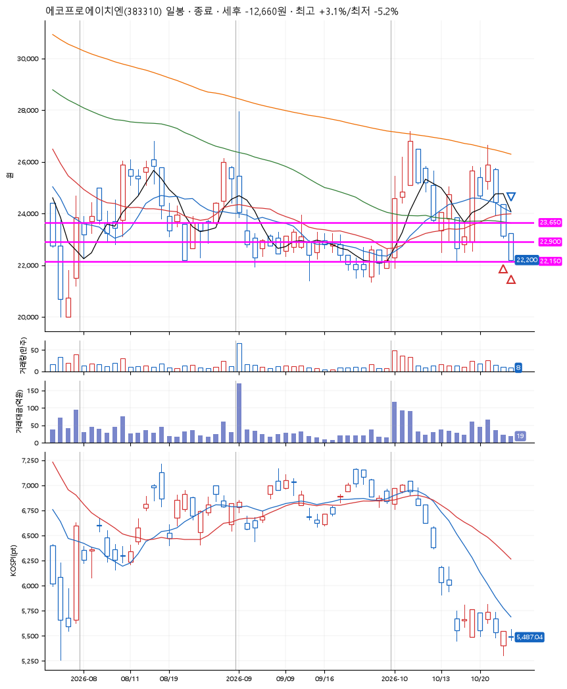
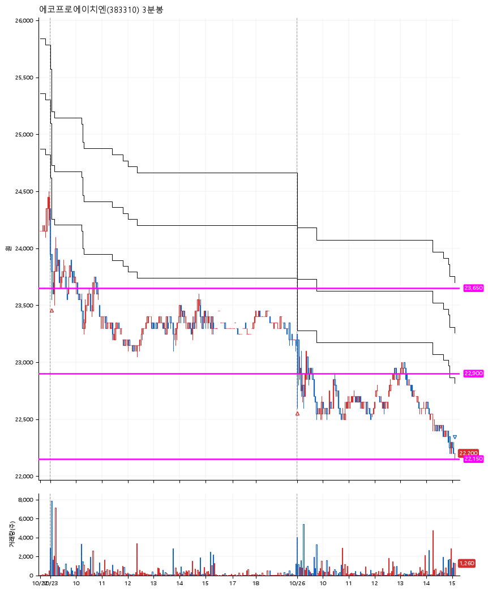

# 에코프로에이치엔(383310) · 2026-10-26

**2차 매수 → 손절**

진입 2026-10-23 09:03 (D+4) · 청산 2026-10-26 15:06 (D+5) · 보유 2일차

| | |
|---|---|
| 결과 | 손절 |
| 평단 / 수량 | 23,365원 · 10주 |
| 투입 | 233,650원 |
| 세후 손익 | -12,660원 (-5.42%) |
| 최고 / 최저 | +3.1% / -5.2% |
| 당일 등락 | -3.87% |
| 보유기간 | 4일차 |

## 3선

| | |
|---|---|
| 1선 | 23,650원 |
| 2선 | 22,900원 |
| 3선 | 22,150원 |

기준봉 2026-10-19 (D+5)

`#KOSPI하락횡보장` `#시장을이기는종목`

> 마이크론 신규고객사 확보

## 차트

**일봉**

**3분봉**

## 체결

| 시각 | 구분 | 수량 | 판정가 | 체결가 | 오차 |
|---|---|---|---|---|---|
| 09:03 | 매수 | 5주 | 23,650 | 23,730 | +0.34% |
| 09:00 | 매수 | 5주 | 22,900 | 23,000 | +0.44% |
| 15:06 | 매도 | 10주 | 22,150 | 22,150 | +0.00% |

## 잘한 점

_(미작성)_

## 아쉬운 점

_(미작성)_
