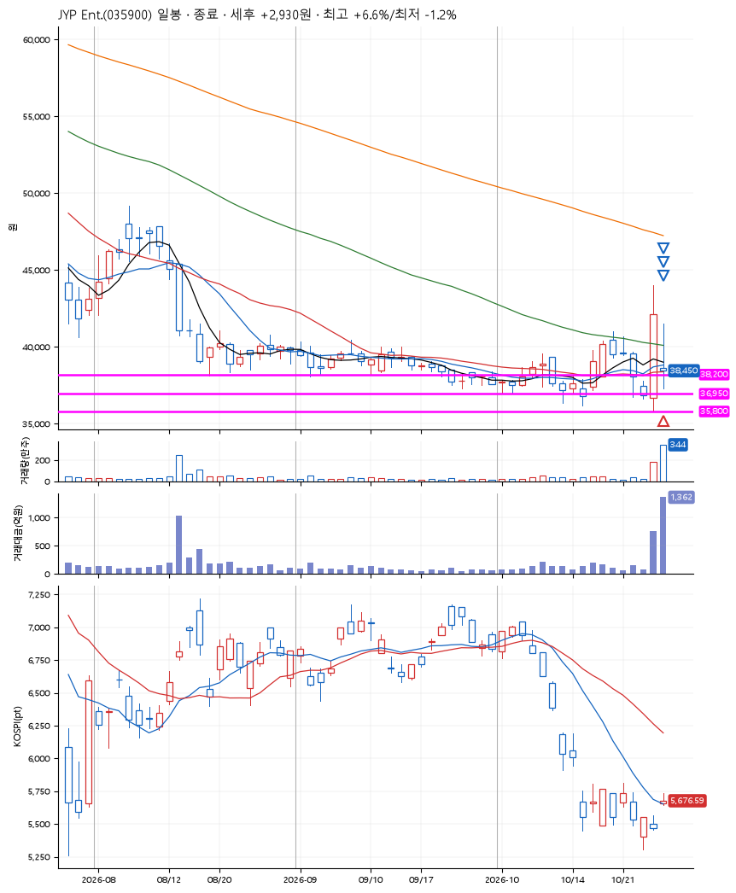
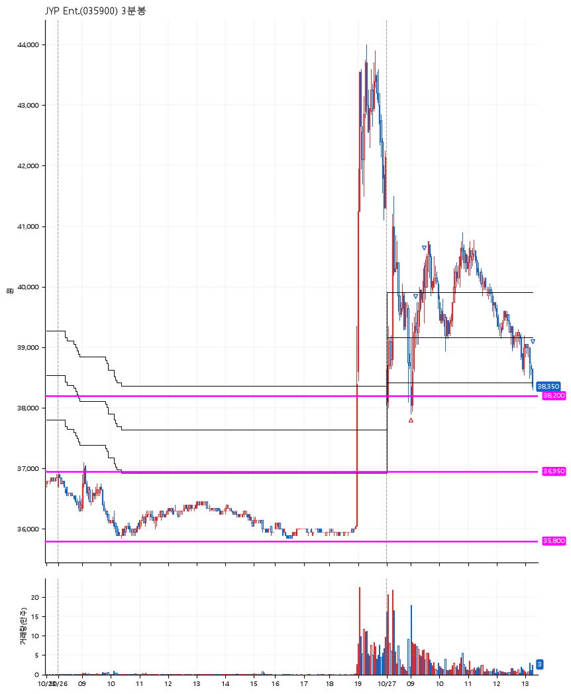

# JYP Ent.(035900) · 2026-10-27

**1차 매수 → 3% 익절 → 5% 익절 → 본절 이탈**

진입 2026-10-27 09:00 (D+1) · 청산 2026-10-27 13:17 (D+1) · 보유 4시간 17분

| | |
|---|---|
| 결과 | 익절 |
| 평단 / 수량 | 38,350원 · 3주 |
| 투입 | 115,050원 |
| 세후 손익 | +2,930원 (+2.55%) |
| 최고 / 최저 | +6.6% / -1.2% |
| 당일 등락 | +0.26% |
| 보유기간 | 4시간 17분 |

## 3선

| | |
|---|---|
| 1선 | 38,200원 |
| 2선 | 36,950원 |
| 3선 | 35,800원 |

기준봉 2026-10-26 (D+1)

`#KOSPI하락횡보장` `#시장을이기는종목`

## 차트

**일봉**

**3분봉**

## 체결

| 시각 | 구분 | 수량 | 판정가 | 체결가 | 오차 |
|---|---|---|---|---|---|
| 09:00 | 매수 | 3주 | 38,200 | 38,350 | +0.39% |
| 09:09 | 매도 | 1주 | 39,550 | 39,550 | +0.00% |
| 09:29 | 매도 | 1주 | 40,300 | 40,250 | -0.12% |
| 13:17 | 매도 | 1주 | 38,350 | 38,450 | +0.26% |

## 잘한 점

_(미작성)_

## 아쉬운 점

_(미작성)_
