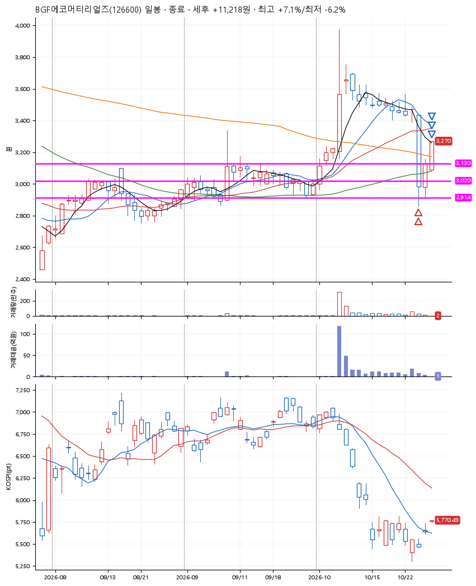
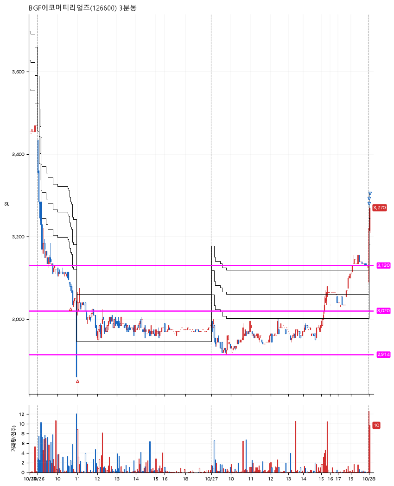

# BGF에코머티리얼즈(126600) · 2026-10-28

**2차 매수 → 3% 익절 → 5% 익절 → 7% 익절**

진입 2026-10-26 10:41 (D+12) · 청산 2026-10-28 09:04 (D+14) · 보유 3일차

| | |
|---|---|
| 결과 | 익절 |
| 평단 / 수량 | 3,050원 · 89주 |
| 투입 | 271,420원 |
| 세후 손익 | +11,218원 (+4.13%) |
| 최고 / 최저 | +7.1% / -6.2% |
| 당일 등락 | +4.53% |
| 보유기간 | 3일차 |

## 3선

| | |
|---|---|
| 1선 | 3,130원 |
| 2선 | 3,020원 |
| 3선 | 2,914원 |

기준봉 2026-10-07 (D+14)

`#KOSPI하락횡보장` `#시장을이기는종목`

## 차트

**일봉**

**3분봉**

## 체결

| 시각 | 구분 | 수량 | 판정가 | 체결가 | 오차 |
|---|---|---|---|---|---|
| 10:41 | 매수 | 44주 | 3,075 | 3,080 | +0.16% |
| 11:00 | 매수 | 45주 | 3,020 | 3,020 | +0.00% |
| 09:01 | 매도 | 35주 | 3,145 | 3,140 | -0.16% |
| 09:01 | 매도 | 45주 | 3,205 | 3,202 | -0.09% |
| 09:04 | 매도 | 9주 | 3,265 | 3,255 | -0.31% |

## 잘한 점

_(미작성)_

## 아쉬운 점

_(미작성)_
