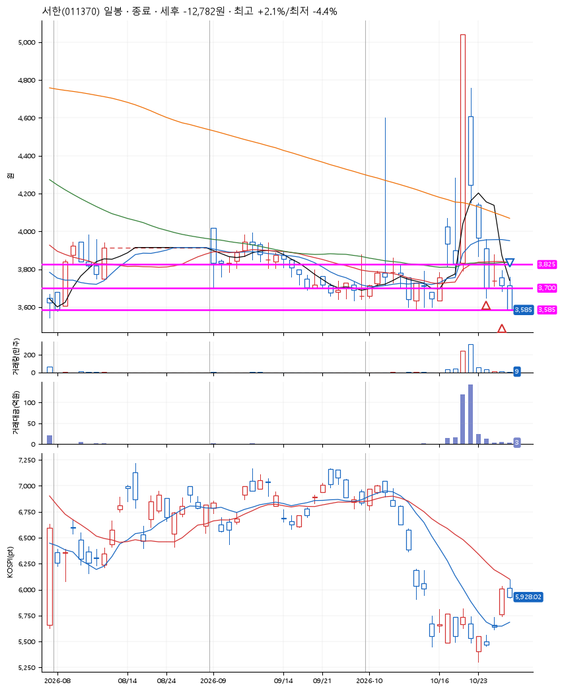
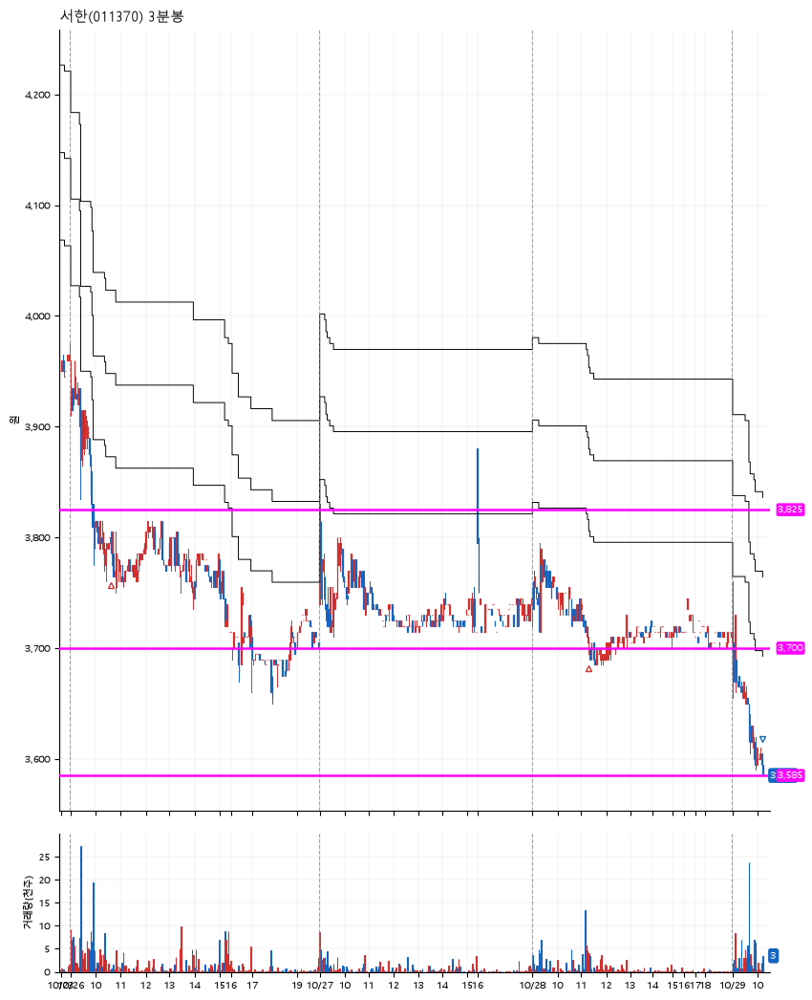

# 서한(011370) · 2026-10-29

**2차 매수 → 손절**

진입 2026-10-26 10:36 (D+3) · 청산 2026-10-29 10:14 (D+6) · 보유 4일차

| | |
|---|---|
| 결과 | 손절 |
| 평단 / 수량 | 3,752원 · 73주 |
| 투입 | 273,885원 |
| 세후 손익 | -12,782원 (-4.67%) |
| 최고 / 최저 | +2.1% / -4.4% |
| 당일 등락 | -2.42% |
| 보유기간 | 4일차 |

## 3선

| | |
|---|---|
| 1선 | 3,825원 |
| 2선 | 3,700원 |
| 3선 | 3,585원 |

기준봉 2026-10-21 (D+6)

`#KOSPI하락횡보장` `#시장을이기는종목` `#상한가` `#테마주`

> 건설 중소형

## 차트

**일봉**

**3분봉**

## 체결

| 시각 | 구분 | 수량 | 판정가 | 체결가 | 오차 |
|---|---|---|---|---|---|
| 10:36 | 매수 | 36주 | 3,800 | 3,800 | +0.00% |
| 11:18 | 매수 | 37주 | 3,700 | 3,705 | +0.14% |
| 10:14 | 매도 | 73주 | 3,585 | 3,585 | +0.00% |

## 잘한 점

_(미작성)_

## 아쉬운 점

_(미작성)_
