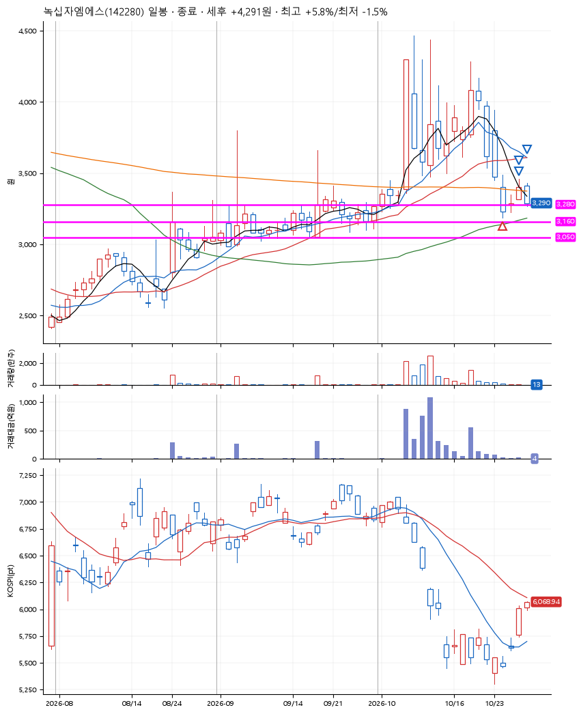
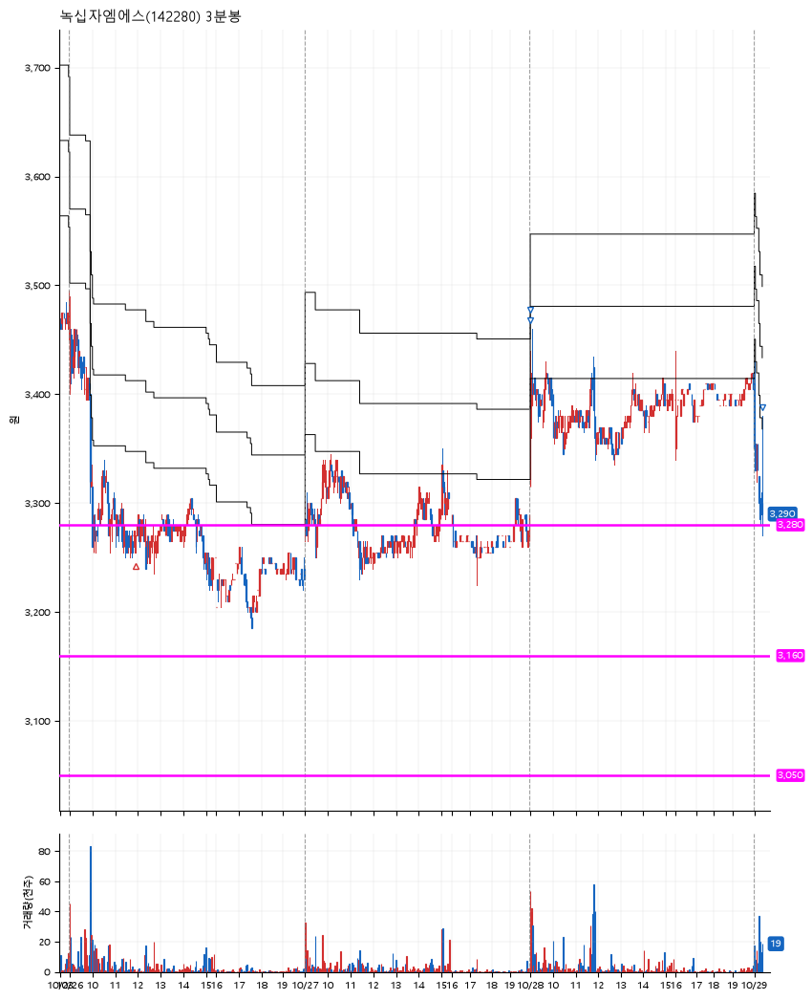

# 녹십자엠에스(142280) · 2026-10-29

**1차 매수 → 3% 익절 → 5% 익절 → 본절 이탈**

진입 2026-10-26 11:55 (D+12) · 청산 2026-10-29 09:23 (D+15) · 보유 4일차

| | |
|---|---|
| 결과 | 익절 |
| 평단 / 수량 | 3,270원 · 42주 |
| 투입 | 137,340원 |
| 세후 손익 | +4,291원 (+3.12%) |
| 최고 / 최저 | +5.8% / -1.5% |
| 당일 등락 | -7.33% |
| 보유기간 | 4일차 |

## 3선

| | |
|---|---|
| 1선 | 3,280원 |
| 2선 | 3,160원 |
| 3선 | 3,050원 |

기준봉 2026-10-07 (D+15)

`#KOSPI하락횡보장` `#시장을이기는종목` `#상한가` `#테마주`

> 제약 바이오

## 차트

**일봉**

**3분봉**

## 체결

| 시각 | 구분 | 수량 | 판정가 | 체결가 | 오차 |
|---|---|---|---|---|---|
| 11:55 | 매수 | 42주 | 3,255 | 3,270 | +0.46% |
| 09:01 | 매도 | 16주 | 3,370 | 3,375 | +0.15% |
| 09:01 | 매도 | 21주 | 3,435 | 3,405 | -0.87% |
| 09:23 | 매도 | 5주 | 3,270 | 3,290 | +0.61% |

## 잘한 점

_(미작성)_

## 아쉬운 점

_(미작성)_
