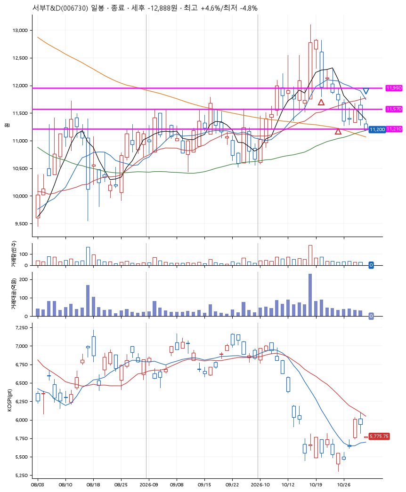
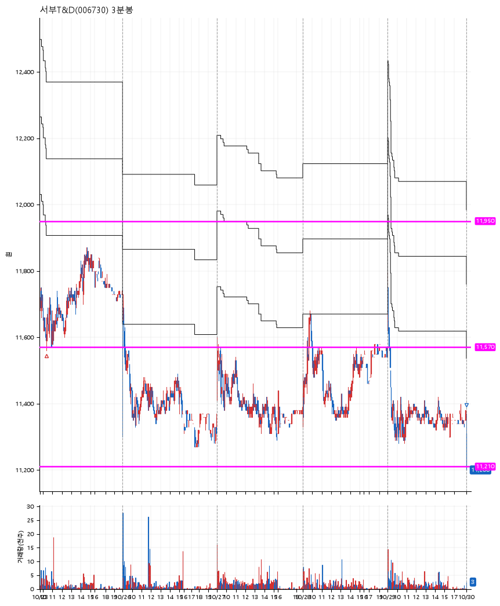

# 서부T&D(006730) · 2026-10-30

**2차 매수 → 손절**

진입 2026-10-20 11:07 (D+2) · 청산 2026-10-30 09:00 (D+10) · 보유 9일차

| | |
|---|---|
| 결과 | 손절 |
| 평단 / 수량 | 11,770원 · 22주 |
| 투입 | 258,940원 |
| 세후 손익 | -12,888원 (-4.98%) |
| 최고 / 최저 | +4.6% / -4.8% |
| 당일 등락 | -1.06% |
| 보유기간 | 11일차 |

## 3선

| | |
|---|---|
| 1선 | 11,950원 |
| 2선 | 11,570원 |
| 3선 | 11,210원 |

기준봉 2026-10-16 (D+10)

`#KOSPI하락횡보장` `#시장을이기는종목`

## 차트

**일봉**

**3분봉**

## 체결

| 시각 | 구분 | 수량 | 판정가 | 체결가 | 오차 |
|---|---|---|---|---|---|
| 11:07 | 매수 | 11주 | 11,950 | 11,960 | +0.08% |
| 10:21 | 매수 | 11주 | 11,570 | 11,580 | +0.09% |
| 09:00 | 매도 | 22주 | 11,210 | 11,210 | +0.00% |

## 잘한 점

_(미작성)_

## 아쉬운 점

_(미작성)_
