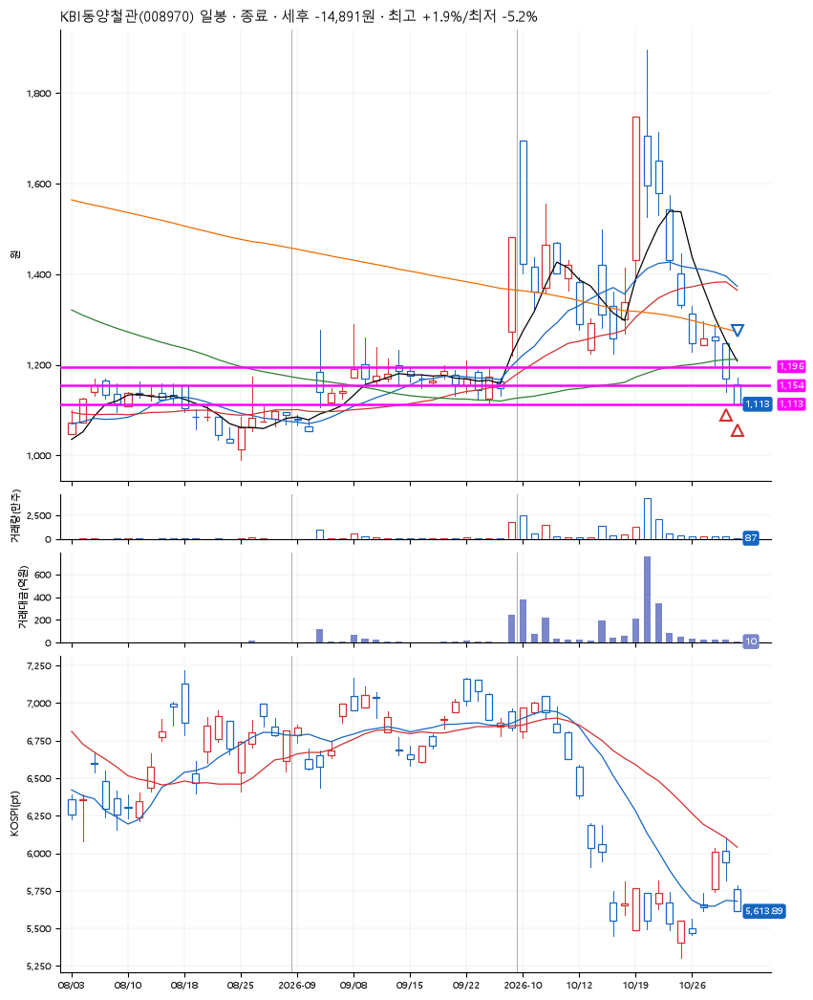
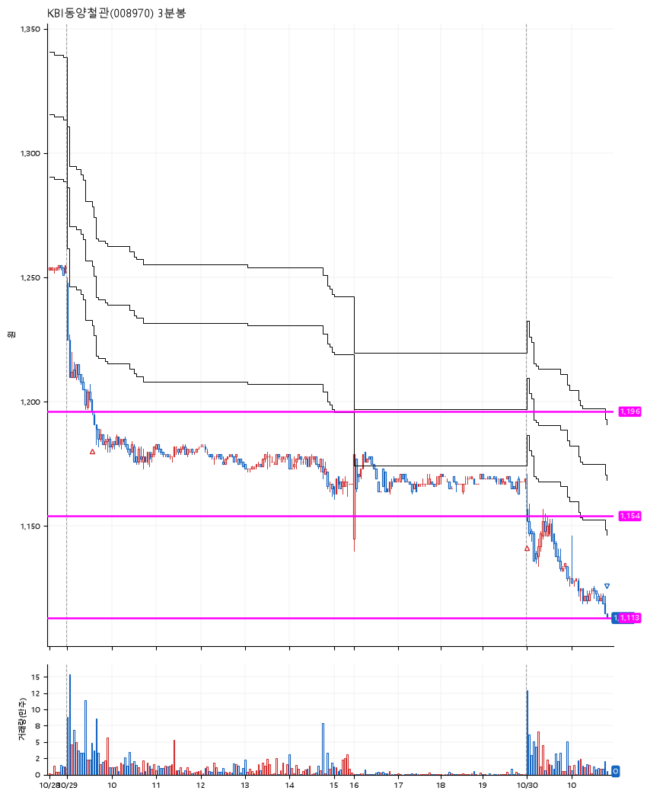

# KBI동양철관(008970) · 2026-10-30

**2차 매수 → 손절**

진입 2026-10-29 09:35 (D+8) · 청산 2026-10-30 10:48 (D+9) · 보유 2일차

| | |
|---|---|
| 결과 | 손절 |
| 평단 / 수량 | 1,175원 · 232주 |
| 투입 | 272,512원 |
| 세후 손익 | -14,891원 (-5.46%) |
| 최고 / 최저 | +1.9% / -5.2% |
| 당일 등락 | -4.93% |
| 보유기간 | 2일차 |

## 3선

| | |
|---|---|
| 1선 | 1,196원 |
| 2선 | 1,154원 |
| 3선 | 1,113원 |

기준봉 2026-10-19 (D+9)

`#KOSPI하락횡보장` `#시장을이기는종목` `#상한가` `#테마주`

> 철강 강관 스페이스X

## 차트

**일봉**

**3분봉**

## 체결

| 시각 | 구분 | 수량 | 판정가 | 체결가 | 오차 |
|---|---|---|---|---|---|
| 09:35 | 매수 | 114주 | 1,196 | 1,197 | +0.08% |
| 09:02 | 매수 | 118주 | 1,153 | 1,153 | +0.00% |
| 10:48 | 매도 | 232주 | 1,113 | 1,113 | +0.00% |

## 잘한 점

_(미작성)_

## 아쉬운 점

_(미작성)_
