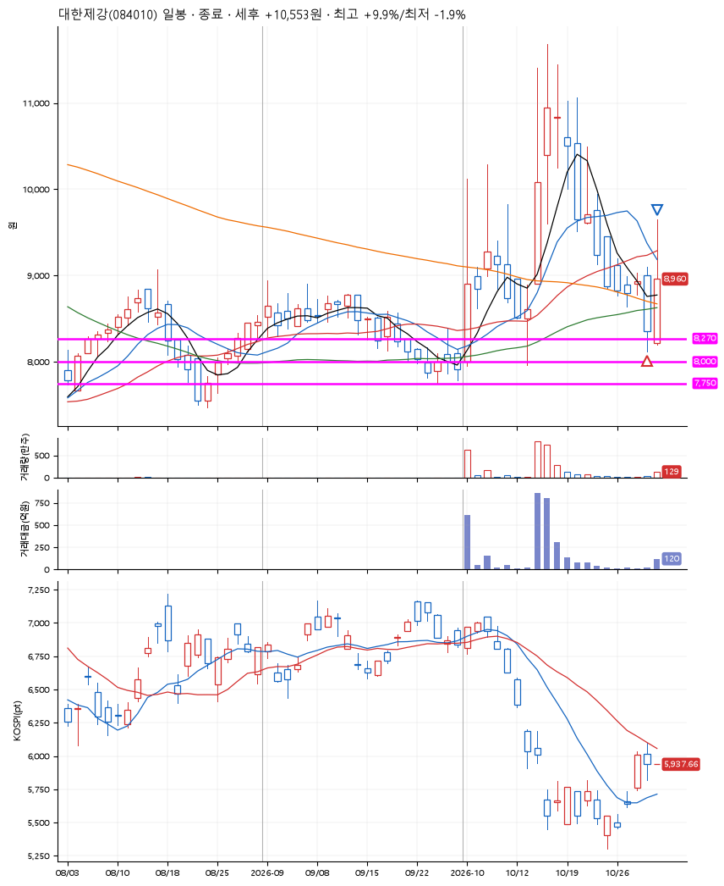
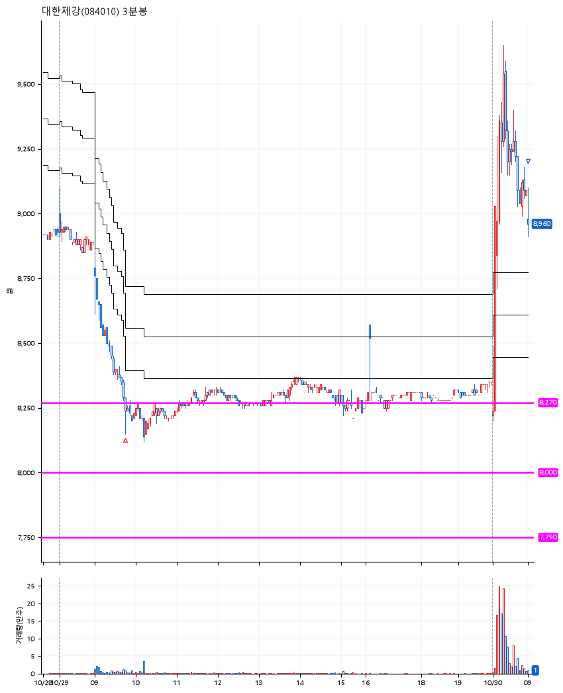

# 대한제강(084010) · 2026-10-30

**1차 매수 → 7% 익절**

진입 2026-10-29 09:45 (D+10) · 청산 2026-10-30 09:00 (D+11) · 보유 2일차

| | |
|---|---|
| 결과 | 익절 |
| 평단 / 수량 | 8,280원 · 16주 |
| 투입 | 132,480원 |
| 세후 손익 | +10,553원 (+7.97%) |
| 최고 / 최저 | +9.9% / -1.9% |
| 당일 등락 | -5.90% |
| 보유기간 | 2일차 |

## 3선

| | |
|---|---|
| 1선 | 8,270원 |
| 2선 | 8,000원 |
| 3선 | 7,750원 |

기준봉 2026-10-15 (D+11)

`#KOSPI하락횡보장` `#시장을이기는종목` `#테마주`

> 철강

## 차트

**일봉**

**3분봉**

## 체결

| 시각 | 구분 | 수량 | 판정가 | 체결가 | 오차 |
|---|---|---|---|---|---|
| 09:45 | 매수 | 16주 | 8,270 | 8,280 | +0.12% |
| 09:00 | 매도 | 16주 | 8,980 | 8,960 | -0.22% |

## 잘한 점

_(미작성)_

## 아쉬운 점

_(미작성)_
