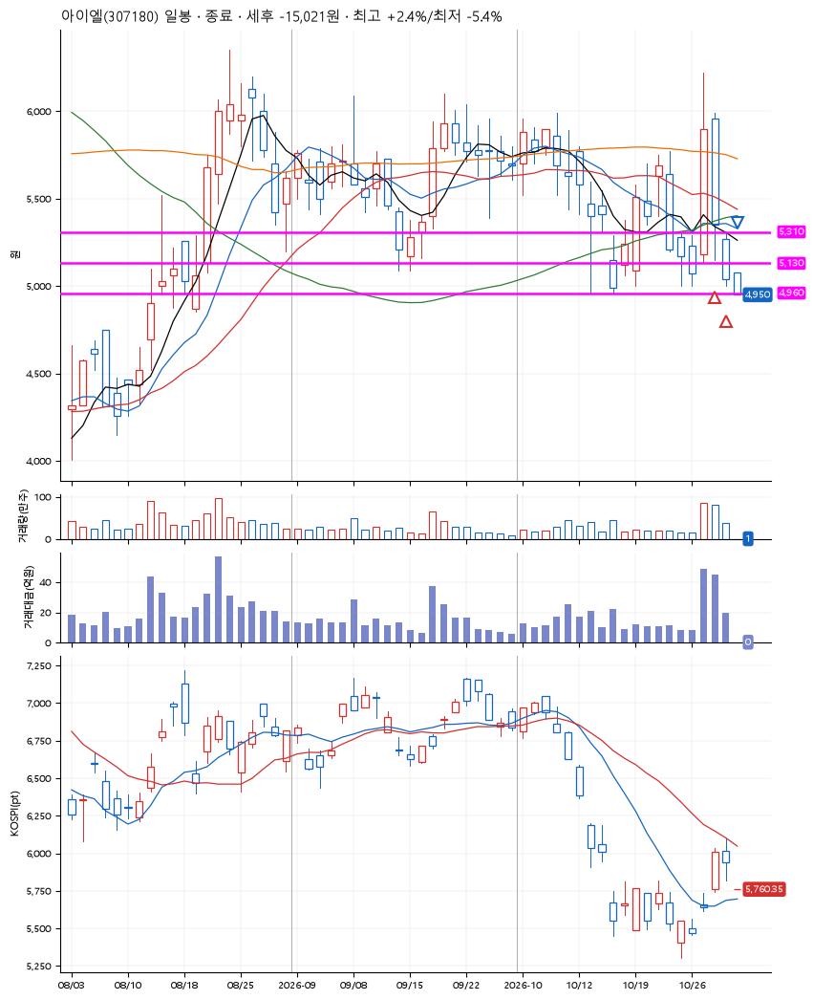
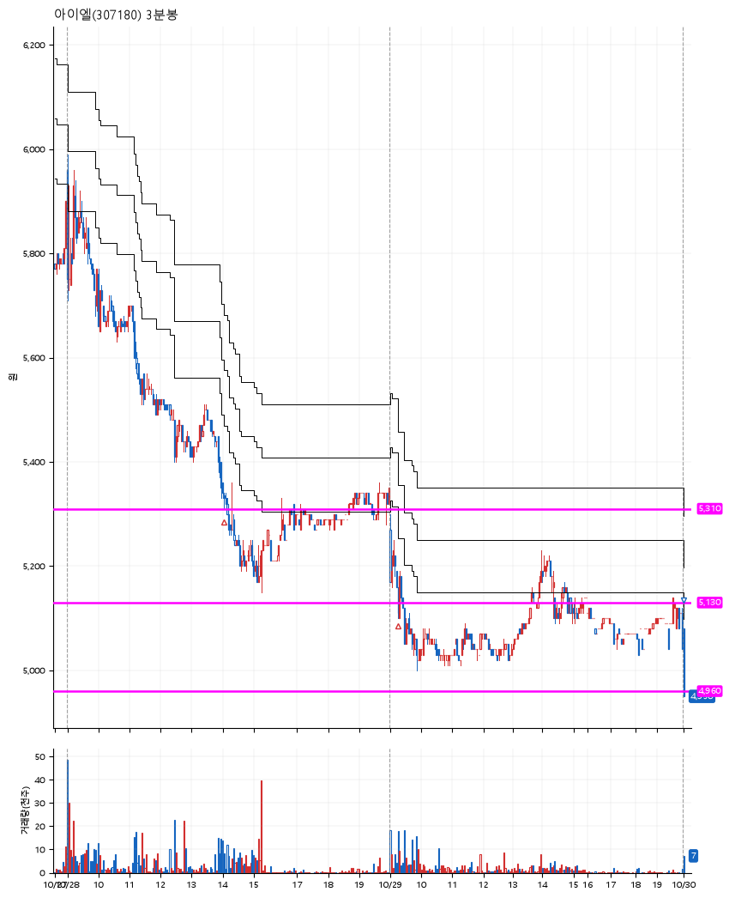

# 아이엘(307180) · 2026-10-30

**2차 매수 → 손절**

진입 2026-10-28 14:04 (D+1) · 청산 2026-10-30 09:00 (D+3) · 보유 3일차

| | |
|---|---|
| 결과 | 손절 |
| 평단 / 수량 | 5,233원 · 51주 |
| 투입 | 266,890원 |
| 세후 손익 | -15,021원 (-5.63%) |
| 최고 / 최저 | +2.4% / -5.4% |
| 당일 등락 | -5.41% |
| 보유기간 | 3일차 |

## 3선

| | |
|---|---|
| 1선 | 5,310원 |
| 2선 | 5,130원 |
| 3선 | 4,960원 |

기준봉 2026-10-27 (D+3)

`#KOSPI하락횡보장` `#시장을이기는종목` `#테마주`

> 로봇 피지컬AI 휴머노이드로봇

## 차트

**일봉**

**3분봉**

## 체결

| 시각 | 구분 | 수량 | 판정가 | 체결가 | 오차 |
|---|---|---|---|---|---|
| 14:04 | 매수 | 25주 | 5,310 | 5,330 | +0.38% |
| 09:15 | 매수 | 26주 | 5,130 | 5,140 | +0.19% |
| 09:00 | 매도 | 51주 | 4,960 | 4,950 | -0.20% |

## 잘한 점

_(미작성)_

## 아쉬운 점

_(미작성)_
