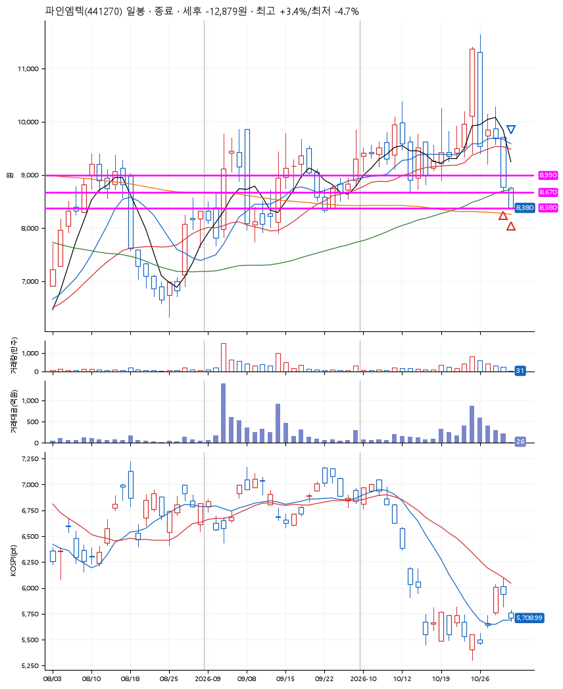
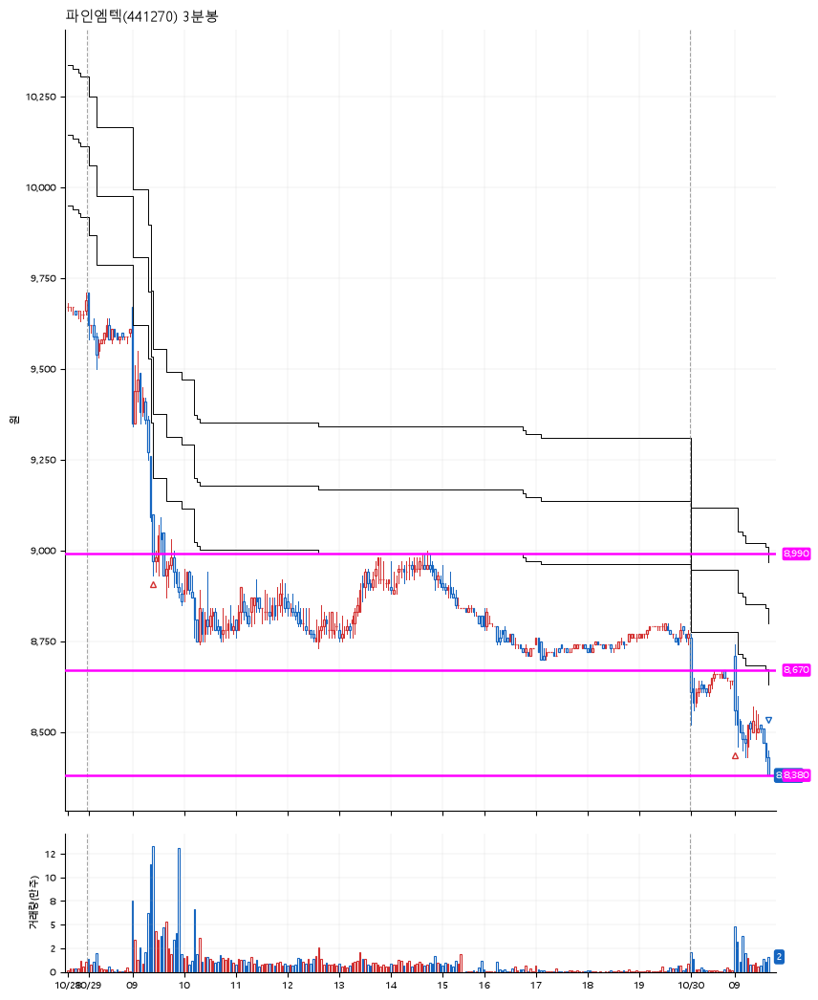

# 파인엠텍(441270) · 2026-10-30

**2차 매수 → 손절**

진입 2026-10-29 09:26 (D+4) · 청산 2026-10-30 09:41 (D+5) · 보유 2일차

| | |
|---|---|
| 결과 | 손절 |
| 평단 / 수량 | 8,790원 · 30주 |
| 투입 | 263,700원 |
| 세후 손익 | -12,879원 (-4.88%) |
| 최고 / 최저 | +3.4% / -4.7% |
| 당일 등락 | -10.79% |
| 보유기간 | 2일차 |

## 3선

| | |
|---|---|
| 1선 | 8,990원 |
| 2선 | 8,670원 |
| 3선 | 8,380원 |

기준봉 2026-10-23 (D+5)

`#KOSPI하락횡보장` `#시장을이기는종목`

## 차트

**일봉**

**3분봉**

## 체결

| 시각 | 구분 | 수량 | 판정가 | 체결가 | 오차 |
|---|---|---|---|---|---|
| 09:26 | 매수 | 15주 | 8,990 | 8,990 | +0.00% |
| 09:00 | 매수 | 15주 | 8,650 | 8,590 | -0.69% |
| 09:41 | 매도 | 30주 | 8,380 | 8,380 | +0.00% |

## 잘한 점

_(미작성)_

## 아쉬운 점

_(미작성)_
