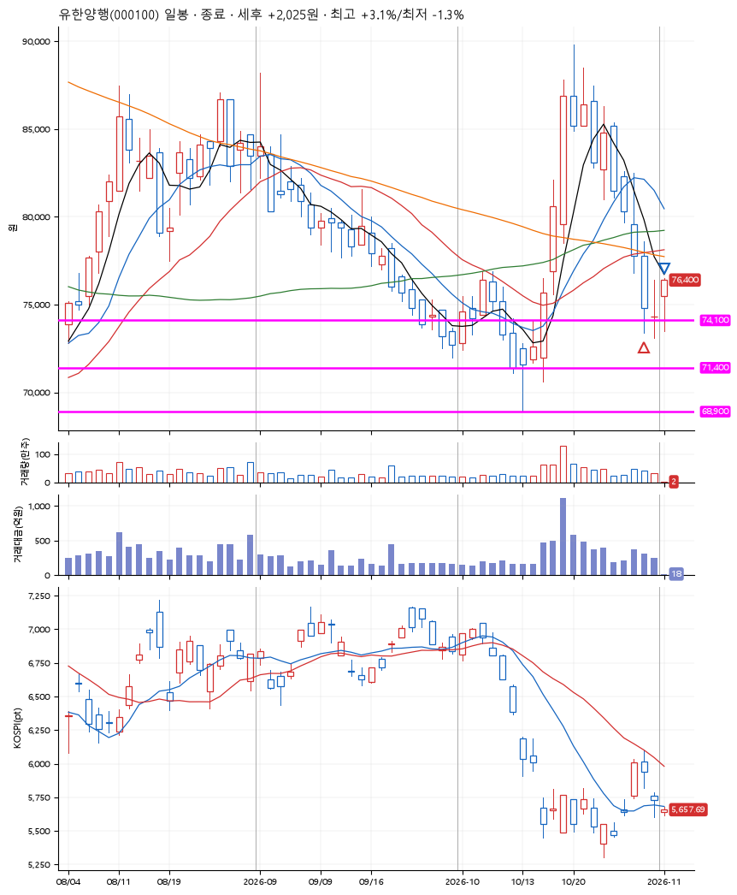
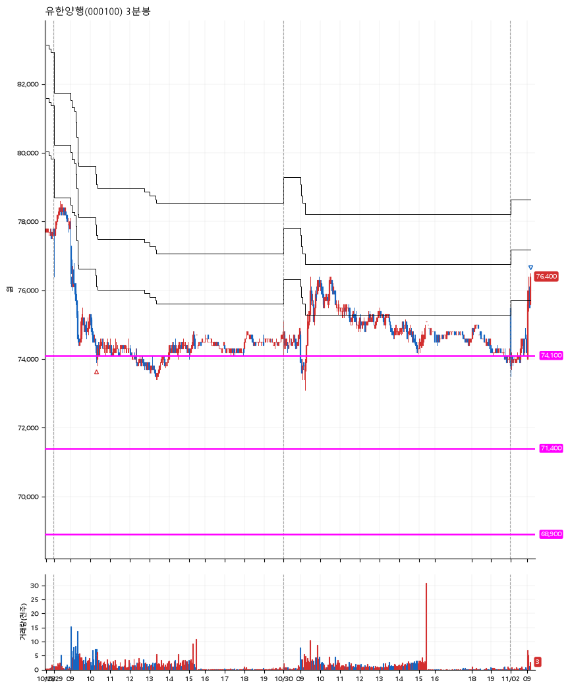

# 유한양행(000100) · 2026-11-02

**1차 매수 → 3% 익절**

진입 2026-10-29 10:19 (D+8) · 청산 2026-11-02 09:10 (D+10) · 보유 3일차

| | |
|---|---|
| 결과 | 익절 |
| 평단 / 수량 | 74,200원 · 1주 |
| 투입 | 74,200원 |
| 세후 손익 | +2,025원 (+2.73%) |
| 최고 / 최저 | +3.1% / -1.3% |
| 당일 등락 | +2.97% |
| 보유기간 | 5일차 |

## 3선

| | |
|---|---|
| 1선 | 74,100원 |
| 2선 | 71,400원 |
| 3선 | 68,900원 |

기준봉 2026-10-19 (D+10)

`#KOSPI하락횡보장` `#시장을이기는종목`

## 차트

**일봉**

**3분봉**

## 체결

| 시각 | 구분 | 수량 | 판정가 | 체결가 | 오차 |
|---|---|---|---|---|---|
| 10:19 | 매수 | 1주 | 74,100 | 74,200 | +0.13% |
| 09:10 | 매도 | 1주 | 76,500 | 76,400 | -0.13% |

## 잘한 점

_(미작성)_

## 아쉬운 점

_(미작성)_
