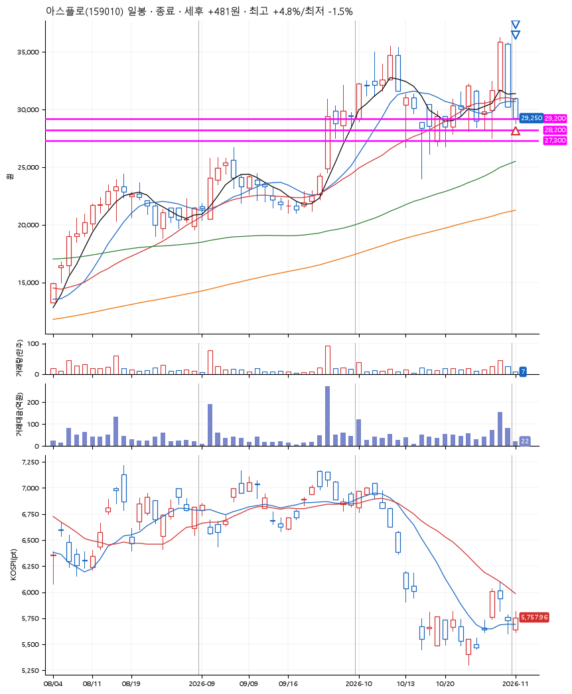
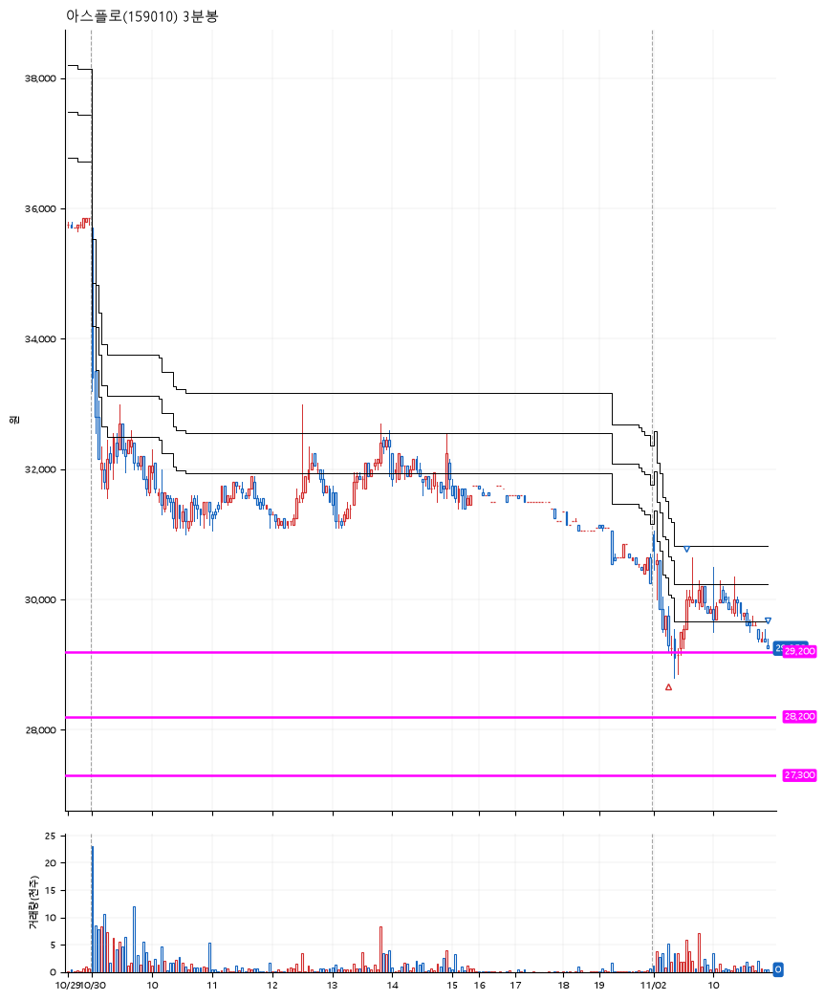

# 아스플로(159010) · 2026-11-02

**1차 매수 → 3% 익절 → 본절 이탈**

진입 2026-11-02 09:17 (D+2) · 청산 2026-11-02 10:56 (D+2) · 보유 1시간 38분

| | |
|---|---|
| 결과 | 익절 |
| 평단 / 수량 | 29,250원 · 4주 |
| 투입 | 117,000원 |
| 세후 손익 | +481원 (+0.41%) |
| 최고 / 최저 | +4.8% / -1.5% |
| 당일 등락 | +4.84% |
| 보유기간 | 1시간 38분 |

## 3선

| | |
|---|---|
| 1선 | 29,200원 |
| 2선 | 28,200원 |
| 3선 | 27,300원 |

기준봉 2026-10-29 (D+2)

`#KOSPI하락횡보장` `#시장을이기는종목` `#테마주`

> 반도체

## 차트

**일봉**

**3분봉**

## 체결

| 시각 | 구분 | 수량 | 판정가 | 체결가 | 오차 |
|---|---|---|---|---|---|
| 09:17 | 매수 | 4주 | 29,200 | 29,250 | +0.17% |
| 09:35 | 매도 | 1주 | 30,150 | 30,000 | -0.50% |
| 10:56 | 매도 | 3주 | 29,250 | 29,250 | +0.00% |

## 잘한 점

_(미작성)_

## 아쉬운 점

_(미작성)_
