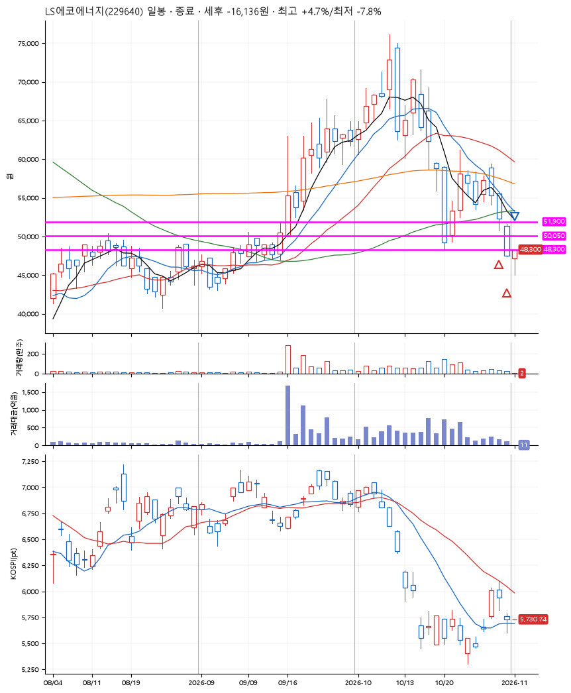
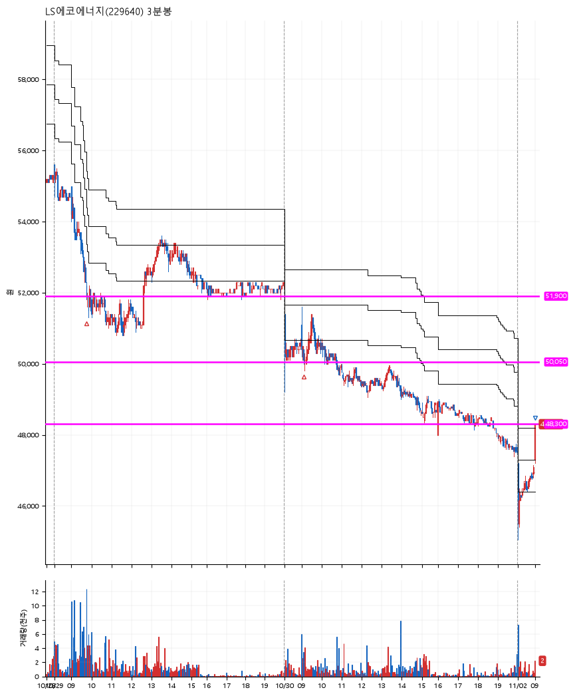

# LS에코에너지(229640) · 2026-11-02

**2차 매수 → 손절**

진입 2026-10-29 09:45 (D+5) · 청산 2026-11-02 09:00 (D+7) · 보유 3일차

| | |
|---|---|
| 결과 | 손절 |
| 평단 / 수량 | 51,200원 · 4주 |
| 투입 | 204,800원 |
| 세후 손익 | -16,136원 (-7.88%) |
| 최고 / 최저 | +4.7% / -7.8% |
| 당일 등락 | +3.38% |
| 보유기간 | 5일차 |

## 3선

| | |
|---|---|
| 1선 | 51,900원 |
| 2선 | 50,050원 |
| 3선 | 48,300원 |

기준봉 2026-10-22 (D+7)

`#KOSPI하락횡보장` `#시장을이기는종목` `#테마주`

> 전선 전력설비 5G

## 차트

**일봉**

**3분봉**

## 체결

| 시각 | 구분 | 수량 | 판정가 | 체결가 | 오차 |
|---|---|---|---|---|---|
| 09:45 | 매수 | 2주 | 51,900 | 52,300 | +0.77% |
| 09:07 | 매수 | 2주 | 50,000 | 50,100 | +0.20% |
| 09:00 | 매도 | 4주 | 47,300 | 47,275 | -0.05% |

## 잘한 점

_(미작성)_

## 아쉬운 점

_(미작성)_
