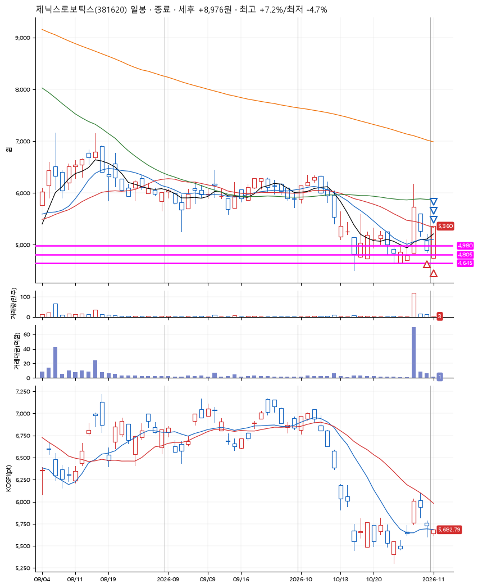
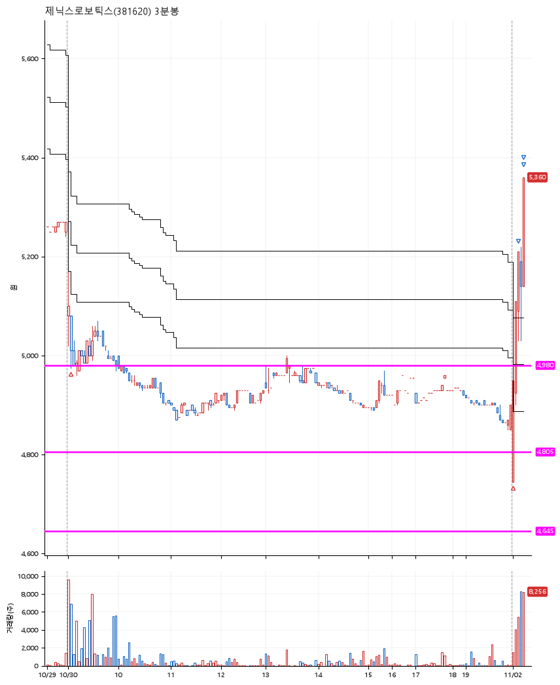

# 제닉스로보틱스(381620) · 2026-11-02

**2차 매수 → 3% 익절 → 5% 익절 → 7% 익절**

진입 2026-10-30 09:04 (D+2) · 청산 2026-11-02 09:13 (D+3) · 보유 2일차

| | |
|---|---|
| 결과 | 익절 |
| 평단 / 수량 | 4,980원 · 55주 |
| 투입 | 273,896원 |
| 세후 손익 | +8,976원 (+3.28%) |
| 최고 / 최저 | +7.2% / -4.7% |
| 당일 등락 | +14.01% |
| 보유기간 | 4일차 |

## 3선

| | |
|---|---|
| 1선 | 4,980원 |
| 2선 | 4,805원 |
| 3선 | 4,645원 |

기준봉 2026-10-28 (D+3)

`#KOSPI하락횡보장` `#시장을이기는종목` `#테마주`

> 스마트팩토리

## 차트

**일봉**

**3분봉**

## 체결

| 시각 | 구분 | 수량 | 판정가 | 체결가 | 오차 |
|---|---|---|---|---|---|
| 09:04 | 매수 | 27주 | 4,980 | 5,068 | +1.77% |
| 09:00 | 매수 | 28주 | 4,745 | 4,895 | +3.16% |
| 09:06 | 매도 | 22주 | 5,130 | 5,090 | -0.78% |
| 09:13 | 매도 | 27주 | 5,230 | 5,180 | -0.96% |
| 09:13 | 매도 | 6주 | 5,340 | 5,280 | -1.12% |

## 잘한 점

_(미작성)_

## 아쉬운 점

_(미작성)_
