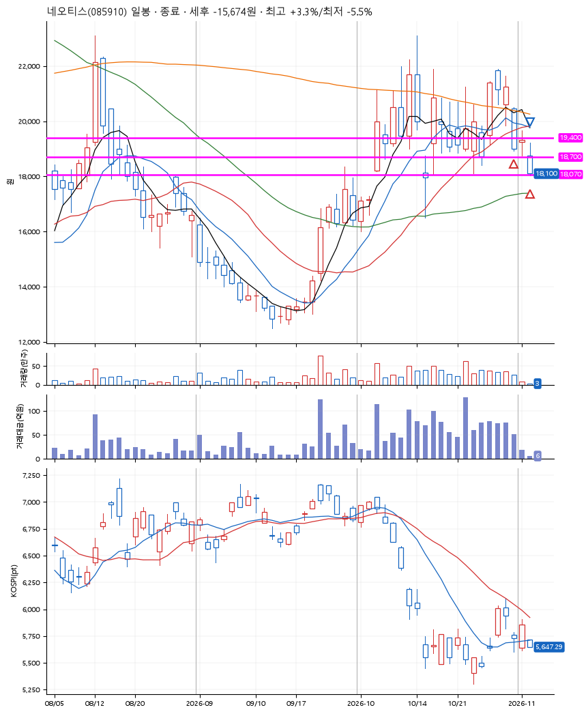
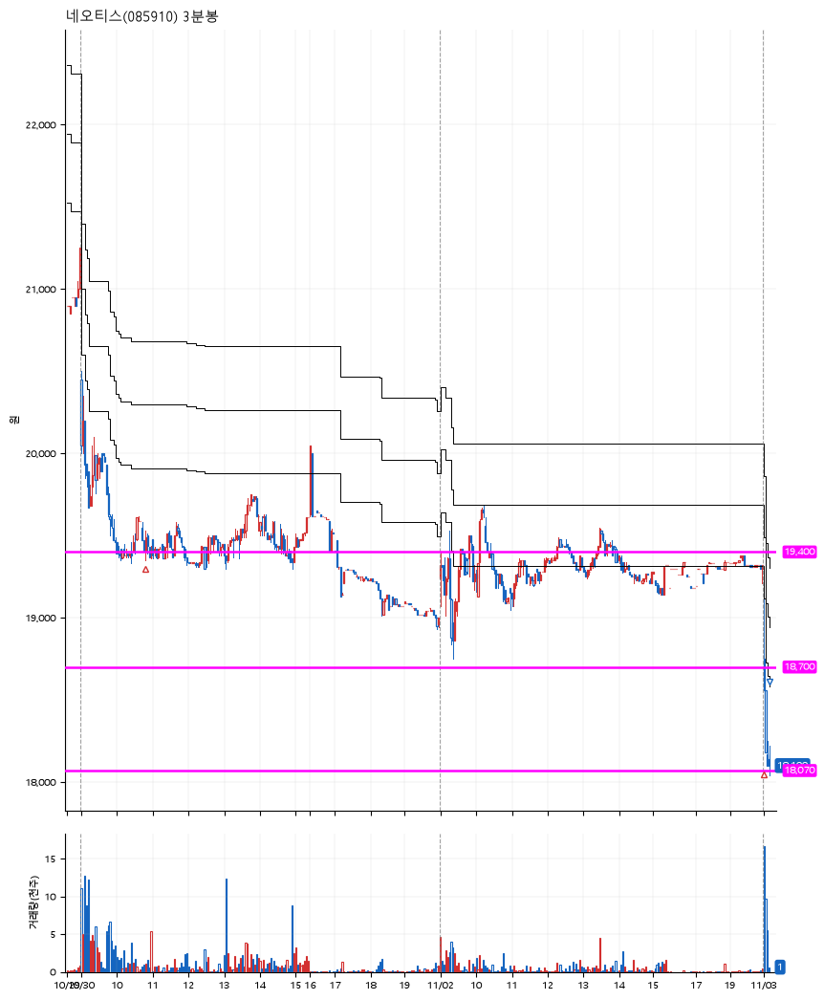

# 네오티스(085910) · 2026-11-03

**2차 매수 → 손절**

진입 2026-10-30 10:48 (D+3) · 청산 2026-11-03 09:09 (D+5) · 보유 3일차

| | |
|---|---|
| 결과 | 손절 |
| 평단 / 수량 | 19,123원 · 14주 |
| 투입 | 267,722원 |
| 세후 손익 | -15,674원 (-5.85%) |
| 최고 / 최저 | +3.3% / -5.5% |
| 당일 등락 | -5.65% |
| 보유기간 | 5일차 |

## 3선

| | |
|---|---|
| 1선 | 19,400원 |
| 2선 | 18,700원 |
| 3선 | 18,070원 |

기준봉 2026-10-27 (D+5)

`#KOSPI하락횡보장` `#시장을이기는종목` `#테마주`

> 반도체 전기차

## 차트

**일봉**

**3분봉**

## 체결

| 시각 | 구분 | 수량 | 판정가 | 체결가 | 오차 |
|---|---|---|---|---|---|
| 10:48 | 매수 | 7주 | 19,400 | 19,496 | +0.49% |
| 09:01 | 매수 | 7주 | 18,700 | 18,750 | +0.27% |
| 09:09 | 매도 | 14주 | 18,070 | 18,045 | -0.14% |

## 잘한 점

_(미작성)_

## 아쉬운 점

_(미작성)_
