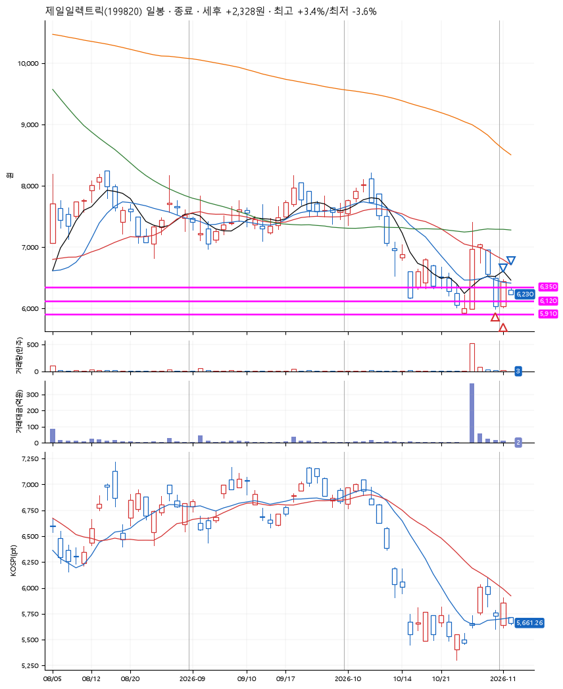
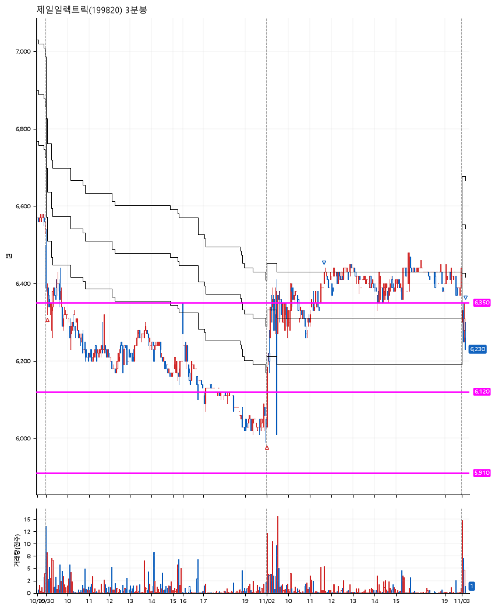

# 제일일렉트릭(199820) · 2026-11-03

**2차 매수 → 3% 익절 → 본절 이탈**

진입 2026-10-30 09:03 (D+3) · 청산 2026-11-03 09:11 (D+5) · 보유 3일차

| | |
|---|---|
| 결과 | 익절 |
| 평단 / 수량 | 6,237원 · 43주 |
| 투입 | 268,170원 |
| 세후 손익 | +2,328원 (+0.87%) |
| 최고 / 최저 | +3.4% / -3.6% |
| 당일 등락 | -3.49% |
| 보유기간 | 5일차 |

## 3선

| | |
|---|---|
| 1선 | 6,350원 |
| 2선 | 6,120원 |
| 3선 | 5,910원 |

기준봉 2026-10-27 (D+5)

`#KOSPI하락횡보장` `#시장을이기는종목` `#테마주`

> 전력설비

## 차트

**일봉**

**3분봉**

## 체결

| 시각 | 구분 | 수량 | 판정가 | 체결가 | 오차 |
|---|---|---|---|---|---|
| 09:03 | 매수 | 21주 | 6,350 | 6,390 | +0.63% |
| 09:00 | 매수 | 22주 | 6,030 | 6,090 | +1.00% |
| 11:41 | 매도 | 17주 | 6,430 | 6,420 | -0.16% |
| 09:11 | 매도 | 26주 | 6,230 | 6,230 | +0.00% |

## 잘한 점

_(미작성)_

## 아쉬운 점

_(미작성)_
