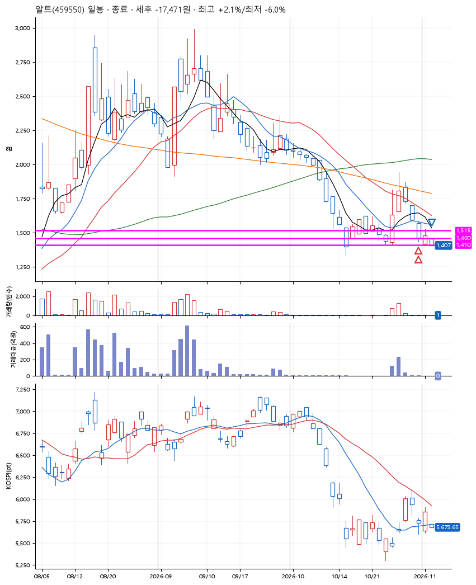
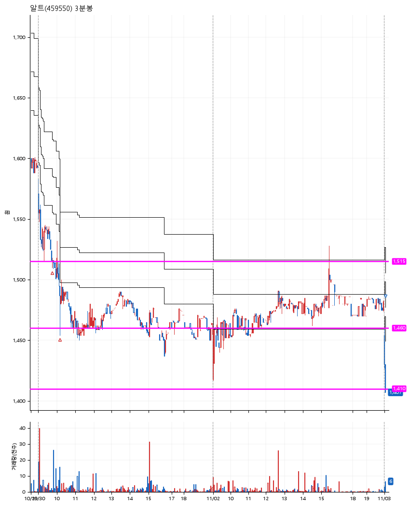

# 알트(459550) · 2026-11-03

**2차 매수 → 손절**

진입 2026-10-30 09:45 (D+3) · 청산 2026-11-03 09:05 (D+5) · 보유 3일차

| | |
|---|---|
| 결과 | 손절 |
| 평단 / 수량 | 1,500원 · 183주 |
| 투입 | 274,542원 |
| 세후 손익 | -17,471원 (-6.36%) |
| 최고 / 최저 | +2.1% / -6.0% |
| 당일 등락 | -4.40% |
| 보유기간 | 5일차 |

## 3선

| | |
|---|---|
| 1선 | 1,515원 |
| 2선 | 1,460원 |
| 3선 | 1,410원 |

기준봉 2026-10-27 (D+5)

`#KOSPI하락횡보장` `#시장을이기는종목` `#테마주`

> 모바일 미디어

## 차트

**일봉**

**3분봉**

## 체결

| 시각 | 구분 | 수량 | 판정가 | 체결가 | 오차 |
|---|---|---|---|---|---|
| 09:45 | 매수 | 90주 | 1,515 | 1,517 | +0.13% |
| 10:10 | 매수 | 93주 | 1,460 | 1,484 | +1.64% |
| 09:05 | 매도 | 183주 | 1,410 | 1,408 | -0.14% |

## 잘한 점

_(미작성)_

## 아쉬운 점

_(미작성)_
