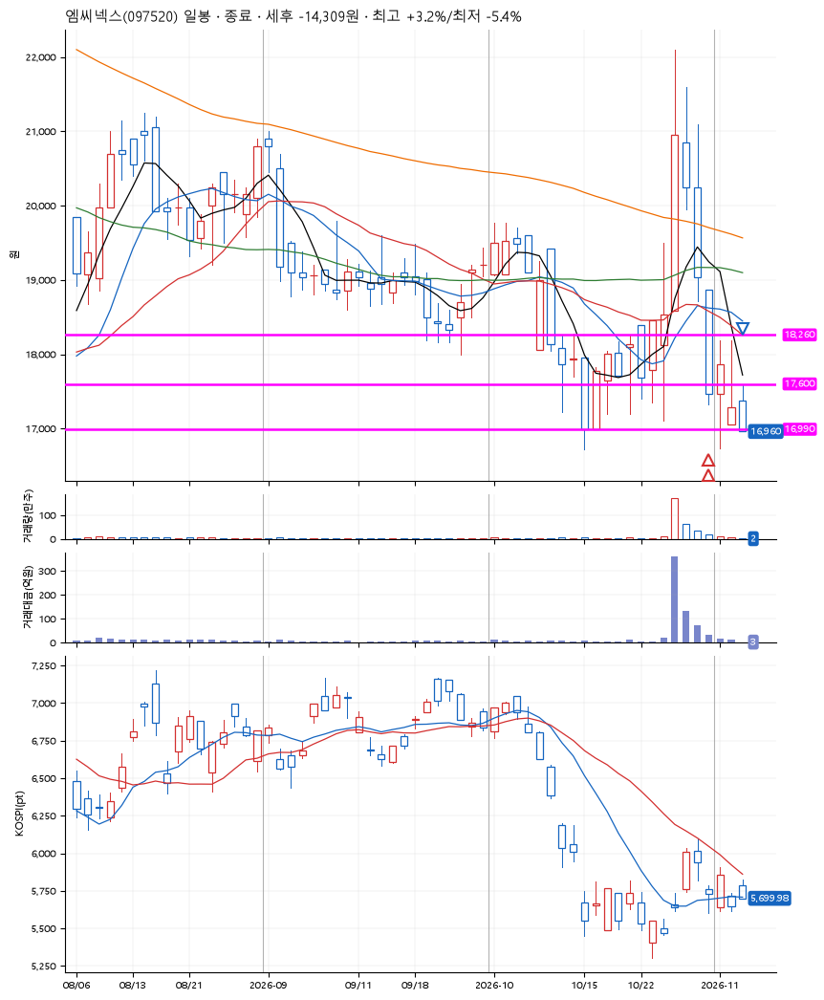
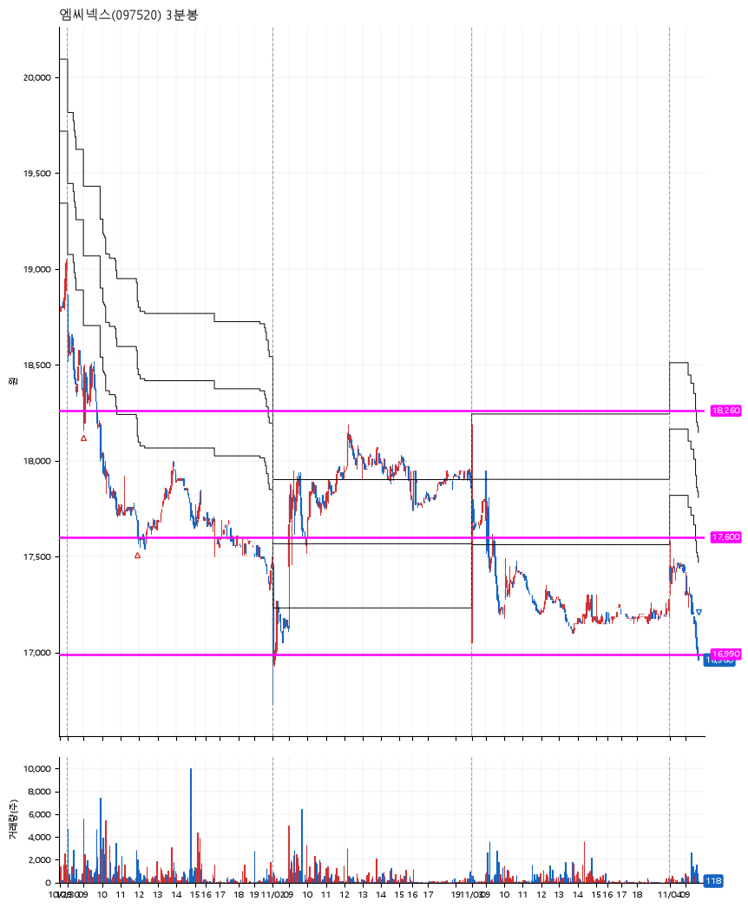

# 엠씨넥스(097520) · 2026-11-04

**2차 매수 → 손절**

진입 2026-10-30 09:01 (D+3) · 청산 2026-11-04 09:42 (D+6) · 보유 4일차

| | |
|---|---|
| 결과 | 손절 |
| 평단 / 수량 | 17,943원 · 14주 |
| 투입 | 251,202원 |
| 세후 손익 | -14,309원 (-5.70%) |
| 최고 / 최저 | +3.2% / -5.4% |
| 당일 등락 | -1.33% |
| 보유기간 | 6일차 |

## 3선

| | |
|---|---|
| 1선 | 18,260원 |
| 2선 | 17,600원 |
| 3선 | 16,990원 |

기준봉 2026-10-27 (D+6)

`#KOSPI하락횡보장` `#시장을이기는종목` `#테마주`

> 현차 휴머노이드로봇 아틀라스

## 차트

**일봉**

**3분봉**

## 체결

| 시각 | 구분 | 수량 | 판정가 | 체결가 | 오차 |
|---|---|---|---|---|---|
| 09:01 | 매수 | 7주 | 18,260 | 18,276 | +0.09% |
| 11:55 | 매수 | 7주 | 17,600 | 17,610 | +0.06% |
| 09:42 | 매도 | 14주 | 16,990 | 16,960 | -0.18% |

## 잘한 점

_(미작성)_

## 아쉬운 점

_(미작성)_
