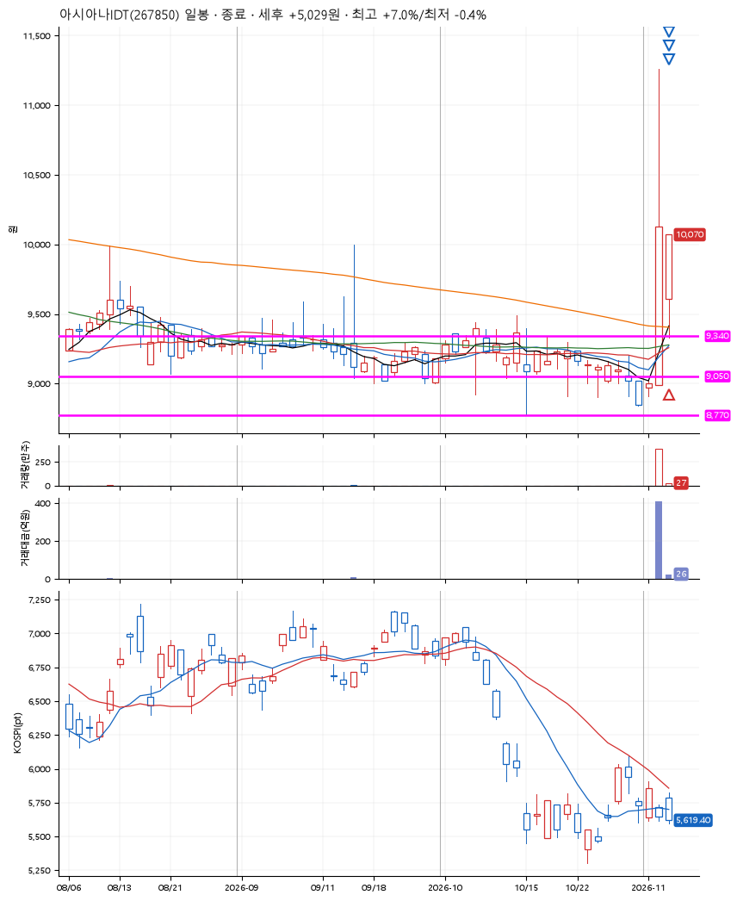
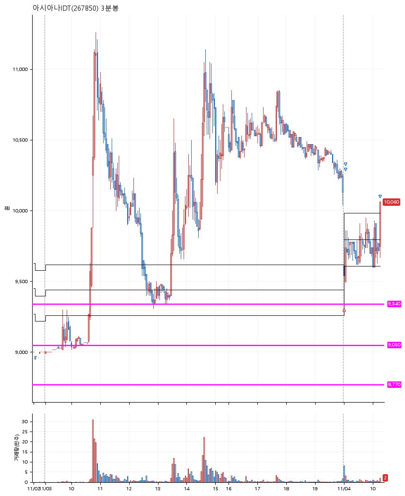

# 아시아나IDT(267850) · 2026-11-04

**1차 매수 → 3% 익절 → 5% 익절 → 7% 익절**

진입 2026-11-04 09:00 (D+1) · 청산 2026-11-04 10:17 (D+1) · 보유 1시간 16분

| | |
|---|---|
| 결과 | 익절 |
| 평단 / 수량 | 9,370원 · 14주 |
| 투입 | 131,180원 |
| 세후 손익 | +5,029원 (+3.83%) |
| 최고 / 최저 | +7.0% / -0.4% |
| 당일 등락 | +0.52% |
| 보유기간 | 1시간 16분 |

## 3선

| | |
|---|---|
| 1선 | 9,340원 |
| 2선 | 9,050원 |
| 3선 | 8,770원 |

기준봉 2026-11-03 (D+1)

`#KOSPI하락횡보장` `#시장을이기는종목`

> 호반그룹 지분 경쟁

## 차트

**일봉**

**3분봉**

## 체결

| 시각 | 구분 | 수량 | 판정가 | 체결가 | 오차 |
|---|---|---|---|---|---|
| 09:00 | 매수 | 14주 | 9,340 | 9,370 | +0.32% |
| 09:04 | 매도 | 5주 | 9,660 | 9,650 | -0.10% |
| 09:05 | 매도 | 7주 | 9,840 | 9,750 | -0.91% |
| 10:17 | 매도 | 2주 | 10,030 | 10,010 | -0.20% |

## 잘한 점

_(미작성)_

## 아쉬운 점

_(미작성)_
