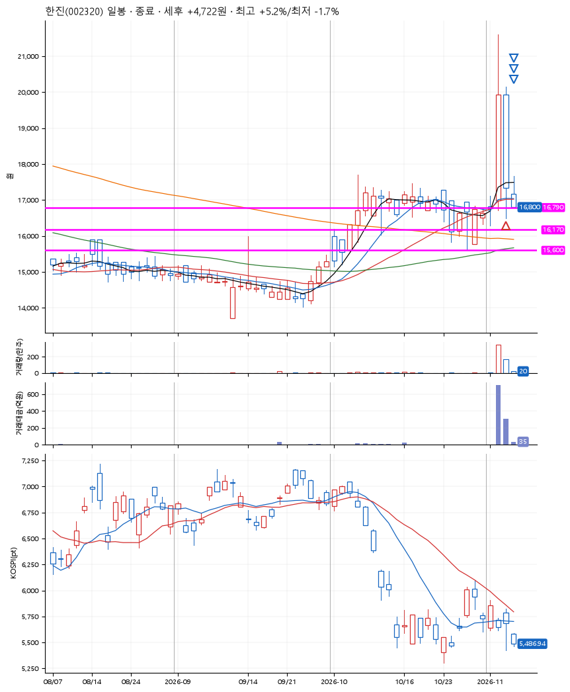
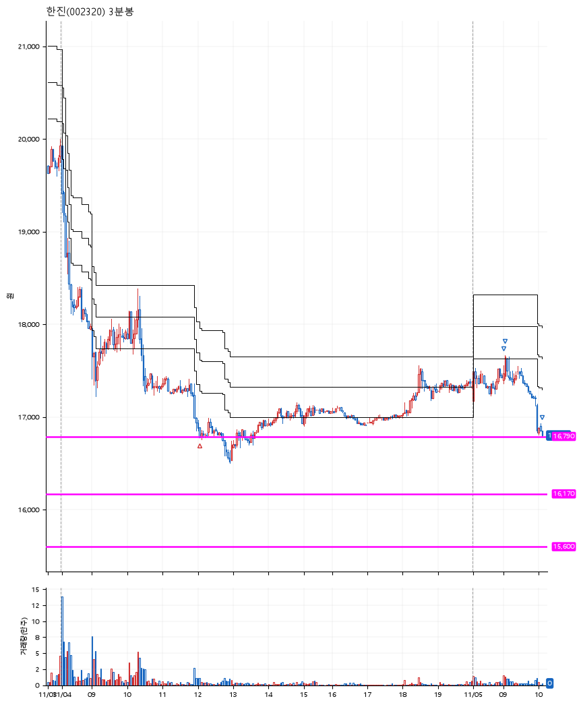

# 한진(002320) · 2026-11-05

**1차 매수 → 3% 익절 → 5% 익절 → 본절 이탈**

진입 2026-11-04 12:04 (D+1) · 청산 2026-11-05 10:06 (D+2) · 보유 2일차

| | |
|---|---|
| 결과 | 익절 |
| 평단 / 수량 | 16,790원 · 8주 |
| 투입 | 134,320원 |
| 세후 손익 | +4,722원 (+3.52%) |
| 최고 / 최저 | +5.2% / -1.7% |
| 당일 등락 | -3.39% |
| 보유기간 | 2일차 |

## 3선

| | |
|---|---|
| 1선 | 16,790원 |
| 2선 | 16,170원 |
| 3선 | 15,600원 |

기준봉 2026-11-03 (D+2)

`#KOSPI하락횡보장` `#시장을이기는종목`

> 호반그룹 지분 경쟁

## 차트

**일봉**

**3분봉**

## 체결

| 시각 | 구분 | 수량 | 판정가 | 체결가 | 오차 |
|---|---|---|---|---|---|
| 12:04 | 매수 | 8주 | 16,790 | 16,790 | +0.00% |
| 09:00 | 매도 | 3주 | 17,400 | 17,360 | -0.23% |
| 09:04 | 매도 | 4주 | 17,630 | 17,620 | -0.06% |
| 10:06 | 매도 | 1주 | 16,790 | 16,800 | +0.06% |

## 잘한 점

_(미작성)_

## 아쉬운 점

_(미작성)_
