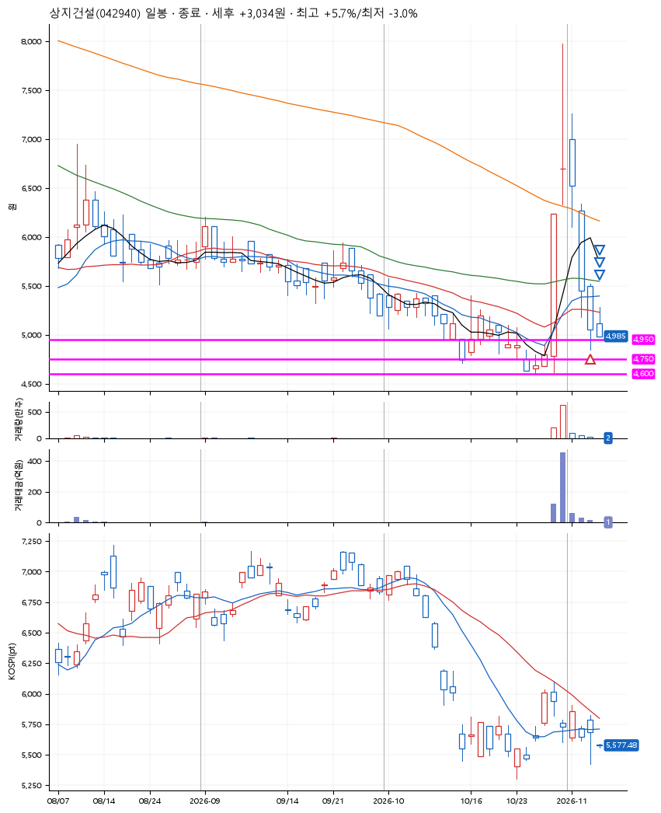
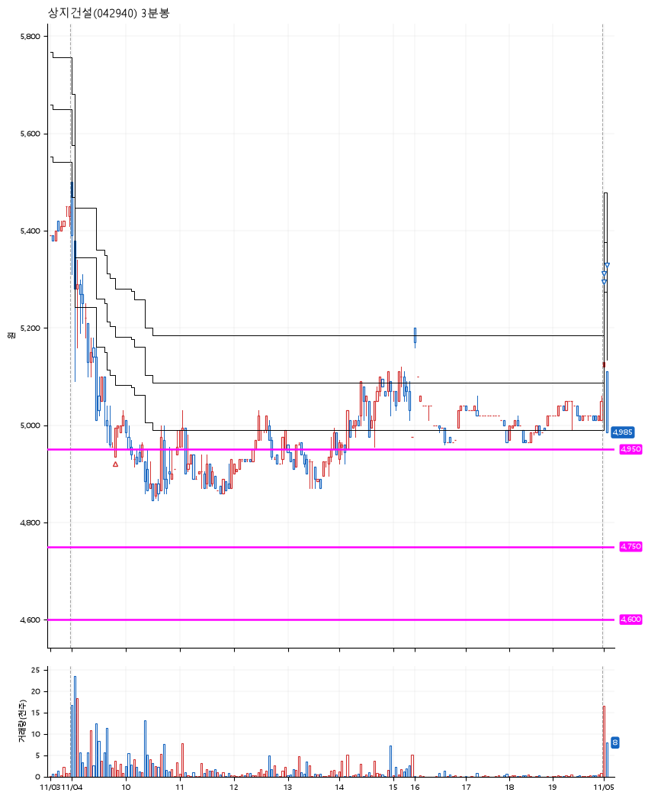

# 상지건설(042940) · 2026-11-05

**1차 매수 → 3% 익절 → 5% 익절 → 본절 이탈**

진입 2026-11-04 09:48 (D+4) · 청산 2026-11-05 09:05 (D+5) · 보유 2일차

| | |
|---|---|
| 결과 | 익절 |
| 평단 / 수량 | 4,995원 · 27주 |
| 투입 | 134,865원 |
| 세후 손익 | +3,034원 (+2.25%) |
| 최고 / 최저 | +5.7% / -3.0% |
| 당일 등락 | -6.15% |
| 보유기간 | 2일차 |

## 3선

| | |
|---|---|
| 1선 | 4,950원 |
| 2선 | 4,750원 |
| 3선 | 4,600원 |

기준봉 2026-10-29 (D+5)

`#KOSPI하락횡보장` `#시장을이기는종목` `#상한가`

> 강남 핵심 개발부지

## 차트

**일봉**

**3분봉**

## 체결

| 시각 | 구분 | 수량 | 판정가 | 체결가 | 오차 |
|---|---|---|---|---|---|
| 09:48 | 매수 | 27주 | 4,935 | 4,995 | +1.22% |
| 09:00 | 매도 | 10주 | 5,150 | 5,130 | -0.39% |
| 09:00 | 매도 | 14주 | 5,250 | 5,140 | -2.10% |
| 09:05 | 매도 | 3주 | 4,990 | 4,985 | -0.10% |

## 잘한 점

_(미작성)_

## 아쉬운 점

_(미작성)_
