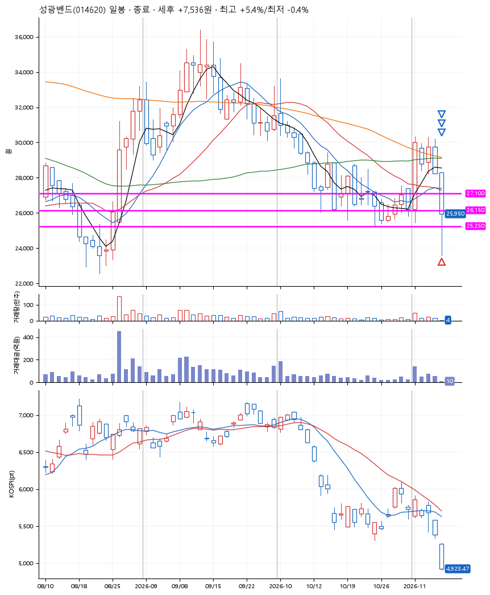
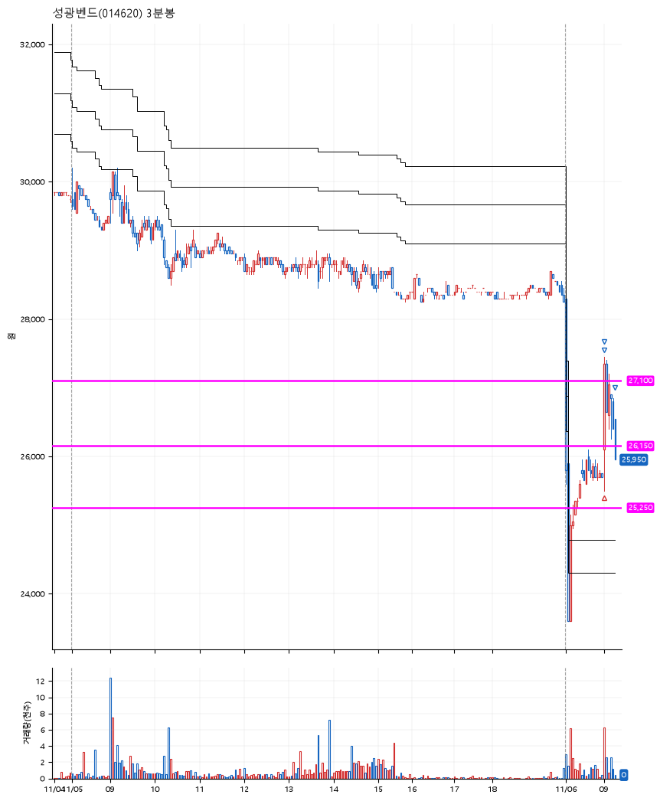

# 성광벤드(014620) · 2026-11-06

**2차 매수 → 3% 익절 → 5% 익절 → 본절 이탈**

진입 2026-11-06 09:00 (D+4) · 청산 2026-11-06 09:17 (D+4) · 보유 16분

| | |
|---|---|
| 결과 | 익절 |
| 평단 / 수량 | 26,000원 · 10주 |
| 투입 | 260,000원 |
| 세후 손익 | +7,536원 (+2.90%) |
| 최고 / 최저 | +5.4% / -0.4% |
| 당일 등락 | -17.62% |
| 보유기간 | 16분 |

## 3선

| | |
|---|---|
| 1선 | 27,100원 |
| 2선 | 26,150원 |
| 3선 | 25,250원 |

기준봉 2026-11-02 (D+4)

`#KOSPI하락횡보장` `#시장을이기는종목` `#테마주`

> 조선기자재 피팅 밸브

## 차트

**일봉**

**3분봉**

## 체결

| 시각 | 구분 | 수량 | 판정가 | 체결가 | 오차 |
|---|---|---|---|---|---|
| 09:00 | 매수 | 10주 | 26,100 | 26,000 | -0.38% |
| 09:01 | 매도 | 4주 | 26,800 | 26,675 | -0.47% |
| 09:02 | 매도 | 5주 | 27,350 | 27,100 | -0.91% |
| 09:17 | 매도 | 1주 | 26,000 | 25,950 | -0.19% |

## 잘한 점

_(미작성)_

## 아쉬운 점

_(미작성)_
