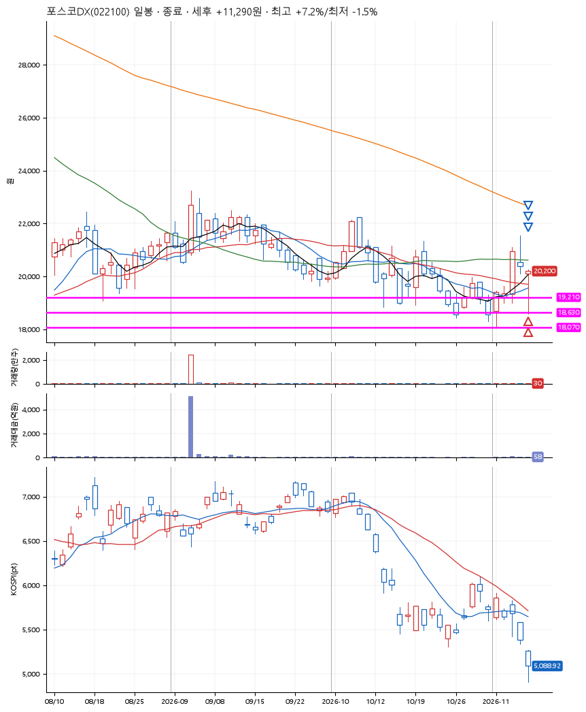
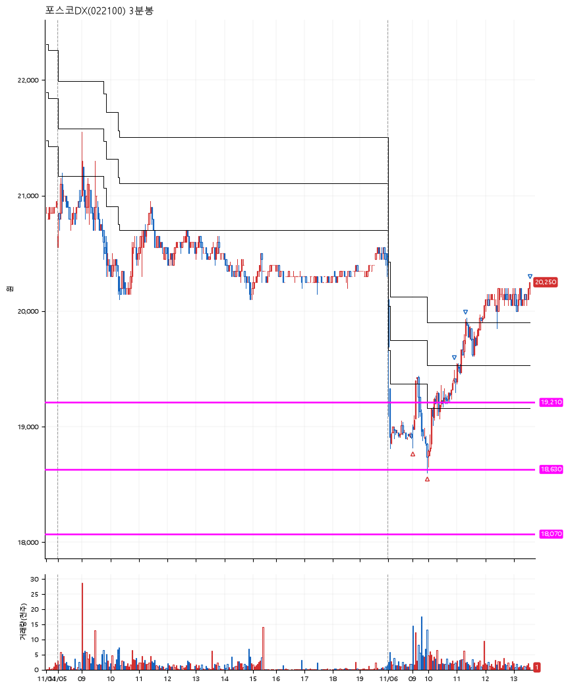

# 포스코DX(022100) · 2026-11-06

**2차 매수 → 3% 익절 → 5% 익절 → 7% 익절**

진입 2026-11-06 09:00 (D+2) · 청산 2026-11-06 13:33 (D+2) · 보유 4시간 32분

| | |
|---|---|
| 결과 | 익절 |
| 평단 / 수량 | 18,885원 · 14주 |
| 투입 | 264,390원 |
| 세후 손익 | +11,290원 (+4.27%) |
| 최고 / 최저 | +7.2% / -1.5% |
| 당일 등락 | +5.53% |
| 보유기간 | 4시간 32분 |

## 3선

| | |
|---|---|
| 1선 | 19,210원 |
| 2선 | 18,630원 |
| 3선 | 18,070원 |

기준봉 2026-11-04 (D+2)

`#KOSPI하락횡보장` `#시장을이기는종목`

## 차트

**일봉**

**3분봉**

## 체결

| 시각 | 구분 | 수량 | 판정가 | 체결가 | 오차 |
|---|---|---|---|---|---|
| 09:00 | 매수 | 7주 | 19,000 | 19,000 | +0.00% |
| 09:59 | 매수 | 7주 | 18,630 | 18,770 | +0.75% |
| 10:55 | 매도 | 5주 | 19,490 | 19,420 | -0.36% |
| 11:18 | 매도 | 7주 | 19,830 | 19,830 | +0.00% |
| 13:33 | 매도 | 2주 | 20,250 | 20,200 | -0.25% |

## 잘한 점

_(미작성)_

## 아쉬운 점

_(미작성)_
