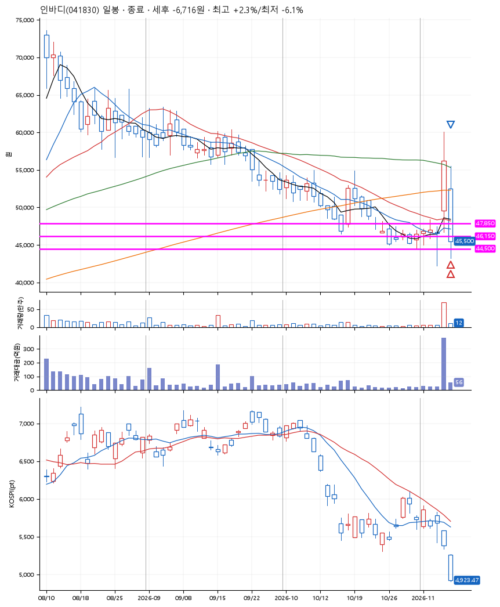
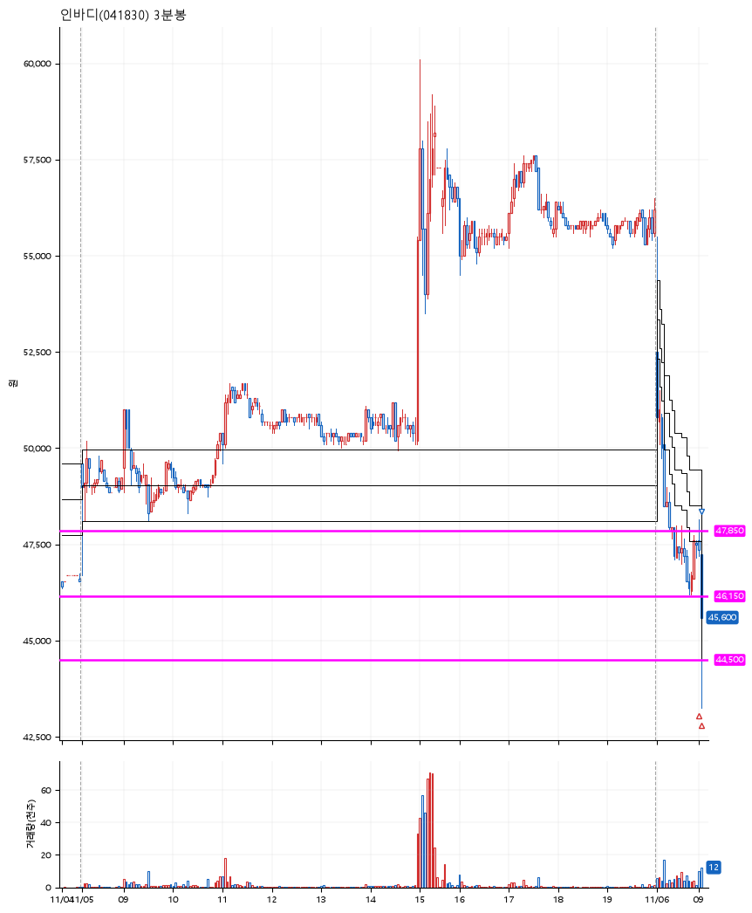

# 인바디(041830) · 2026-11-06

**2차 매수 → 손절**

진입 2026-11-06 09:02 (D+1) · 청산 2026-11-06 09:03 (D+1) · 보유 1분

| | |
|---|---|
| 결과 | 손절 |
| 평단 / 수량 | 46,875원 · 4주 |
| 투입 | 187,500원 |
| 세후 손익 | -6,716원 (-3.58%) |
| 최고 / 최저 | +2.3% / -6.1% |
| 당일 등락 | -11.47% |
| 보유기간 | 1분 |

## 3선

| | |
|---|---|
| 1선 | 47,850원 |
| 2선 | 46,150원 |
| 3선 | 44,500원 |

기준봉 2026-11-05 (D+1)

`#KOSPI하락횡보장` `#시장을이기는종목` `#테마주`

> 의료기기

## 차트

**일봉**

**3분봉**

## 체결

| 시각 | 구분 | 수량 | 판정가 | 체결가 | 오차 |
|---|---|---|---|---|---|
| 09:02 | 매수 | 2주 | 47,500 | 47,550 | +0.11% |
| 09:03 | 매수 | 2주 | 46,150 | 46,200 | +0.11% |
| 09:03 | 매도 | 4주 | 44,500 | 45,300 | +1.80% |

## 잘한 점

_(미작성)_

## 아쉬운 점

_(미작성)_
