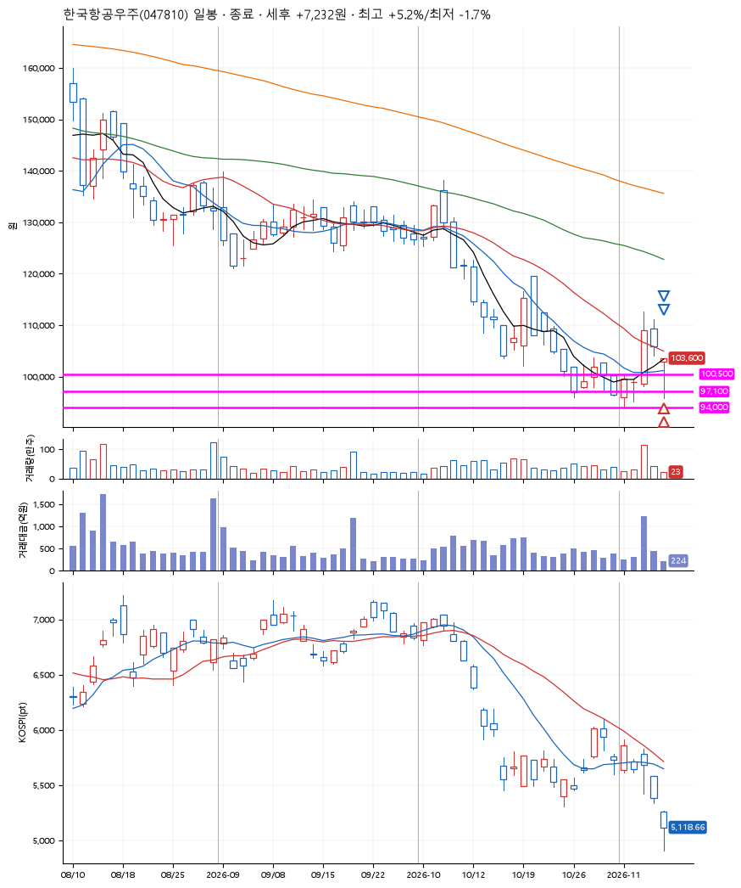
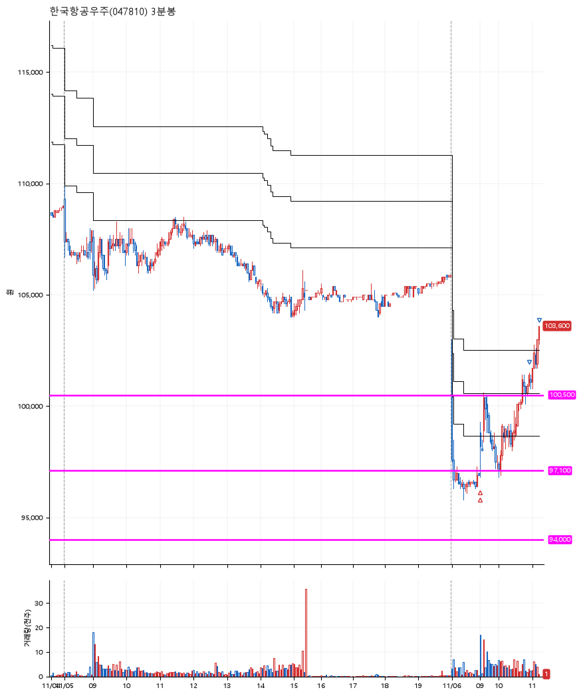

# 한국항공우주(047810) · 2026-11-06

**2차 매수 → 3% 익절 → 5% 익절**

진입 2026-11-06 09:00 (D+2) · 청산 2026-11-06 11:12 (D+2) · 보유 2시간 12분

| | |
|---|---|
| 결과 | 익절 |
| 평단 / 수량 | 98,500원 · 2주 |
| 투입 | 197,000원 |
| 세후 손익 | +7,232원 (+3.67%) |
| 최고 / 최저 | +5.2% / -1.7% |
| 당일 등락 | +3.85% |
| 보유기간 | 2시간 12분 |

## 3선

| | |
|---|---|
| 1선 | 100,500원 |
| 2선 | 97,100원 |
| 3선 | 94,000원 |

기준봉 2026-11-04 (D+2)

`#KOSPI하락횡보장` `#시장을이기는종목`

> 글로벌 전투기

## 차트

**일봉**

**3분봉**

## 체결

| 시각 | 구분 | 수량 | 판정가 | 체결가 | 오차 |
|---|---|---|---|---|---|
| 09:00 | 매수 | 1주 | 98,800 | 98,900 | +0.10% |
| 09:00 | 매수 | 1주 | 97,000 | 98,100 | +1.13% |
| 10:55 | 매도 | 1주 | 101,500 | 101,400 | -0.10% |
| 11:12 | 매도 | 1주 | 103,600 | 103,300 | -0.29% |

## 잘한 점

_(미작성)_

## 아쉬운 점

_(미작성)_
