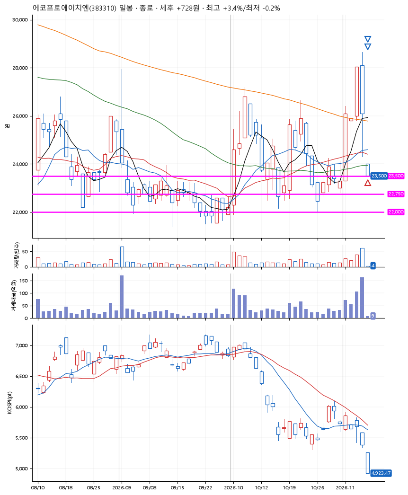
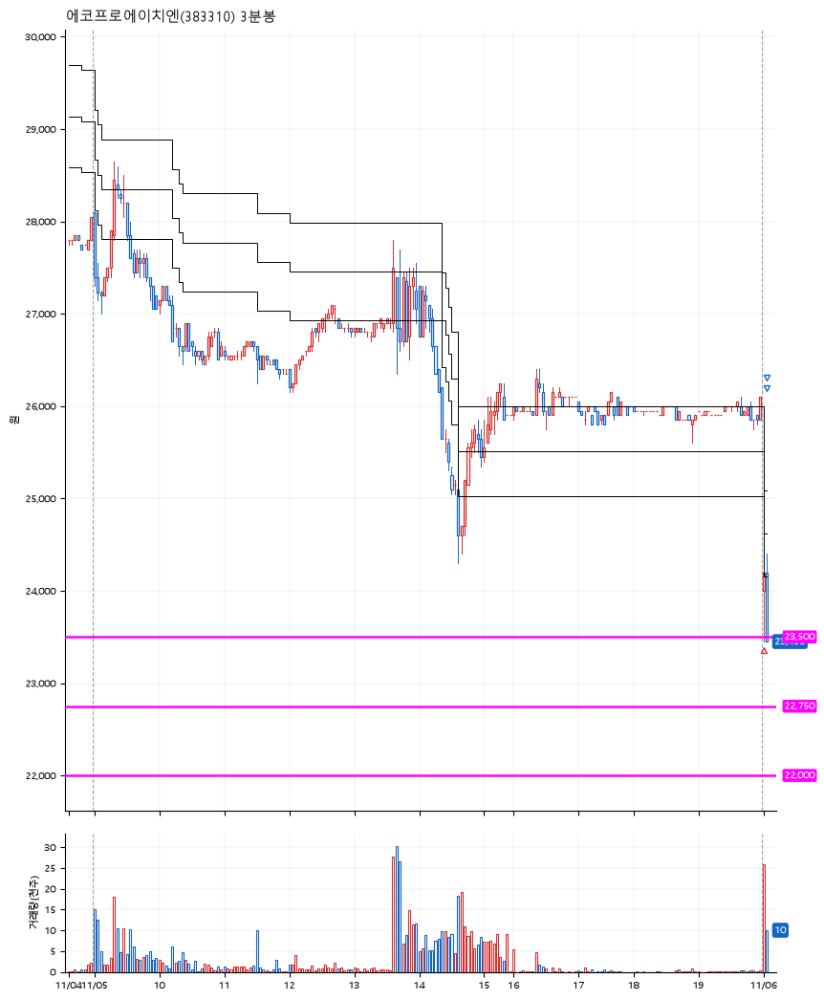

# 에코프로에이치엔(383310) · 2026-11-06

**1차 매수 → 3% 익절 → 본절 이탈**

진입 2026-11-06 09:01 (D+2) · 청산 2026-11-06 09:04 (D+2) · 보유 3분

| | |
|---|---|
| 결과 | 익절 |
| 평단 / 수량 | 23,600원 · 5주 |
| 투입 | 118,000원 |
| 세후 손익 | +728원 (+0.62%) |
| 최고 / 최저 | +3.4% / -0.2% |
| 당일 등락 | -2.71% |
| 보유기간 | 3분 |

## 3선

| | |
|---|---|
| 1선 | 23,500원 |
| 2선 | 22,750원 |
| 3선 | 22,000원 |

기준봉 2026-11-04 (D+2)

`#KOSPI하락횡보장` `#시장을이기는종목`

> 마이크론 신규고객사 확보

## 차트

**일봉**

**3분봉**

## 체결

| 시각 | 구분 | 수량 | 판정가 | 체결가 | 오차 |
|---|---|---|---|---|---|
| 09:01 | 매수 | 5주 | 23,500 | 23,600 | +0.43% |
| 09:03 | 매도 | 2주 | 24,400 | 24,250 | -0.61% |
| 09:04 | 매도 | 3주 | 23,600 | 23,500 | -0.42% |

## 잘한 점

_(미작성)_

## 아쉬운 점

_(미작성)_
