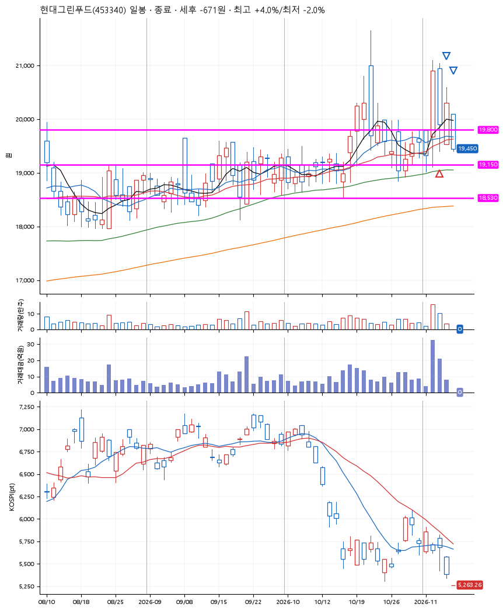
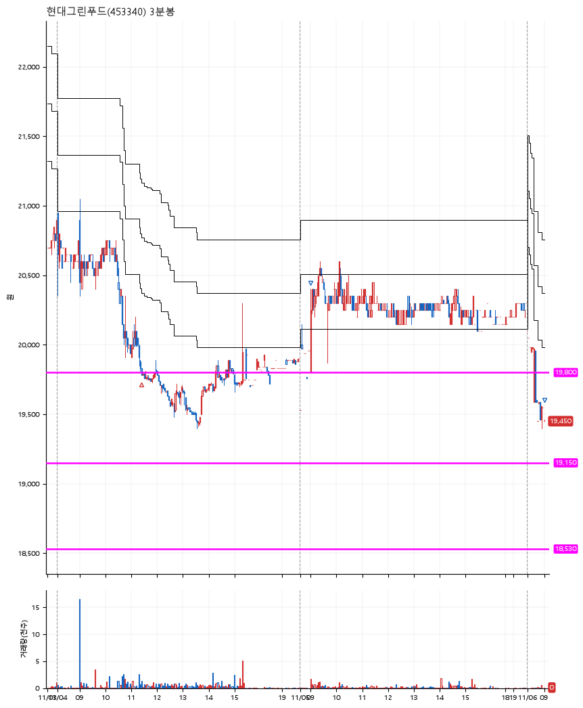

# 현대그린푸드(453340) · 2026-11-06

**1차 매수 → 3% 익절 → 본절 이탈**

진입 2026-11-04 11:24 (D+1) · 청산 2026-11-06 09:00 (D+3) · 보유 3일차

| | |
|---|---|
| 결과 | 손절 |
| 평단 / 수량 | 19,800원 · 6주 |
| 투입 | 118,800원 |
| 세후 손익 | -671원 (-0.56%) |
| 최고 / 최저 | +4.0% / -2.0% |
| 당일 등락 | +4.11% |
| 보유기간 | 3일차 |

## 3선

| | |
|---|---|
| 1선 | 19,800원 |
| 2선 | 19,150원 |
| 3선 | 18,530원 |

기준봉 2026-11-03 (D+3)

`#KOSPI하락횡보장` `#시장을이기는종목`

> 자사주 취득

## 차트

**일봉**

**3분봉**

## 체결

| 시각 | 구분 | 수량 | 판정가 | 체결가 | 오차 |
|---|---|---|---|---|---|
| 11:24 | 매수 | 6주 | 19,800 | 19,800 | +0.00% |
| 09:01 | 매도 | 2주 | 20,400 | 20,300 | -0.49% |
| 09:00 | 매도 | 4주 | 19,450 | 19,450 | +0.00% |

## 잘한 점

_(미작성)_

## 아쉬운 점

_(미작성)_
