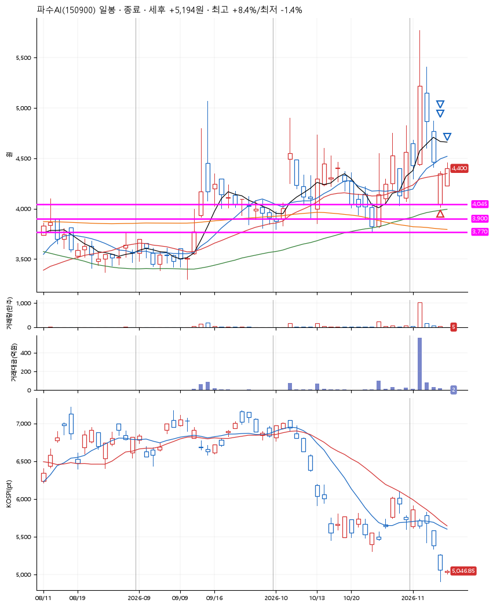
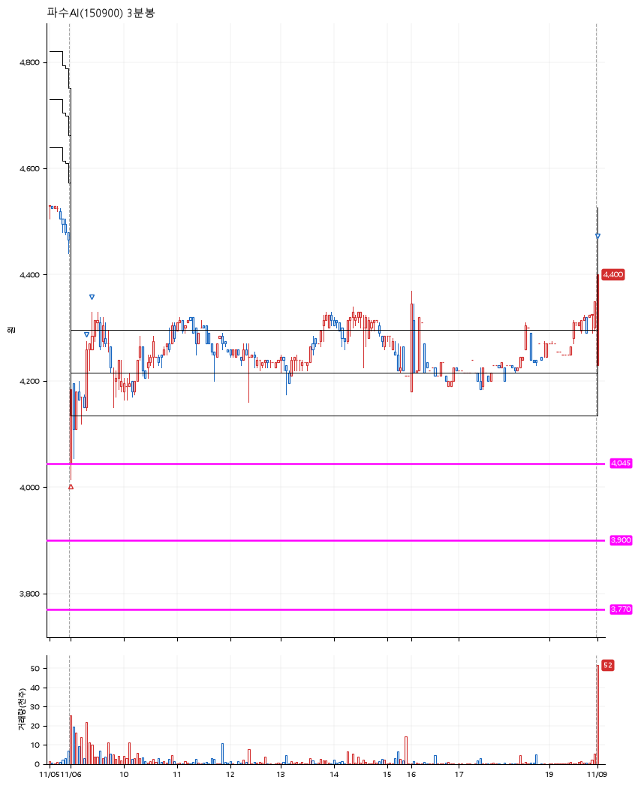

# 파수AI(150900) · 2026-11-09

**1차 매수 → 3% 익절 → 5% 익절 → 7% 익절**

진입 2026-11-06 09:02 (D+3) · 청산 2026-11-09 09:02 (D+4) · 보유 2일차

| | |
|---|---|
| 결과 | 익절 |
| 평단 / 수량 | 4,113원 · 33주 |
| 투입 | 135,729원 |
| 세후 손익 | +5,194원 (+3.83%) |
| 최고 / 최저 | +8.4% / -1.4% |
| 당일 등락 | +6.38% |
| 보유기간 | 4일차 |

## 3선

| | |
|---|---|
| 1선 | 4,045원 |
| 2선 | 3,900원 |
| 3선 | 3,770원 |

기준봉 2026-11-03 (D+4)

`#KOSPI하락횡보장` `#시장을이기는종목` `#테마주`

> 보안주

## 차트

**일봉**

**3분봉**

## 체결

| 시각 | 구분 | 수량 | 판정가 | 체결가 | 오차 |
|---|---|---|---|---|---|
| 09:02 | 매수 | 33주 | 4,045 | 4,113 | +1.68% |
| 09:19 | 매도 | 13주 | 4,255 | 4,220 | -0.82% |
| 09:25 | 매도 | 16주 | 4,320 | 4,299 | -0.49% |
| 09:02 | 매도 | 4주 | 4,405 | 4,400 | -0.11% |

## 잘한 점

_(미작성)_

## 아쉬운 점

_(미작성)_
