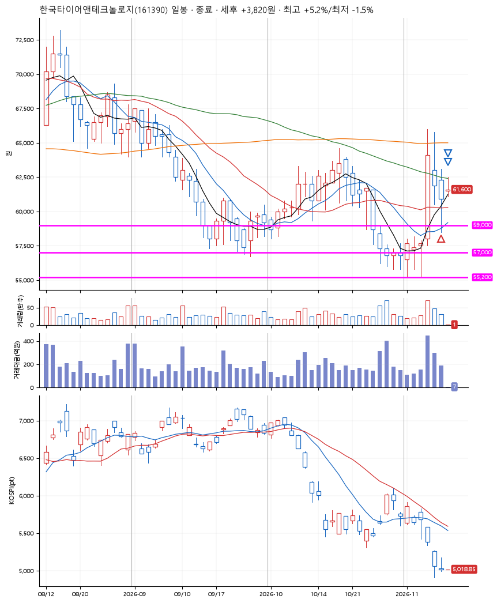
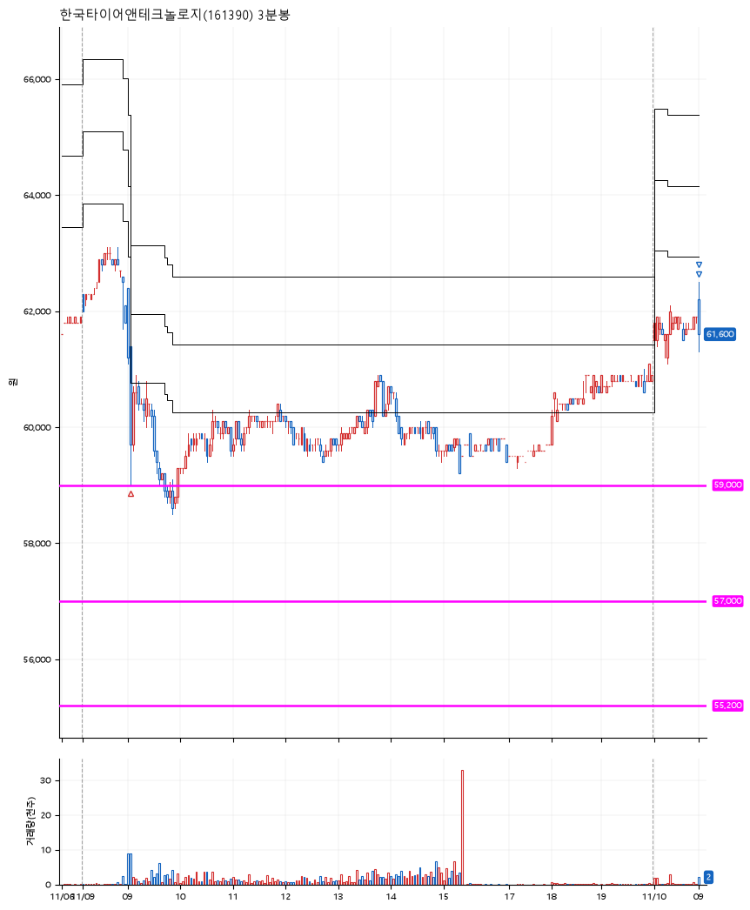

# 한국타이어앤테크놀로지(161390) · 2026-11-10

**1차 매수 → 3% 익절 → 5% 익절**

진입 2026-11-09 09:04 (D+2) · 청산 2026-11-10 09:00 (D+3) · 보유 2일차

| | |
|---|---|
| 결과 | 익절 |
| 평단 / 수량 | 59,400원 · 2주 |
| 투입 | 118,800원 |
| 세후 손익 | +3,820원 (+3.22%) |
| 최고 / 최저 | +5.2% / -1.5% |
| 당일 등락 | +1.61% |
| 보유기간 | 2일차 |

## 3선

| | |
|---|---|
| 1선 | 59,000원 |
| 2선 | 57,000원 |
| 3선 | 55,200원 |

기준봉 2026-11-05 (D+3)

`#KOSPI하락횡보장` `#시장을이기는종목`

## 차트

**일봉**

**3분봉**

## 체결

| 시각 | 구분 | 수량 | 판정가 | 체결가 | 오차 |
|---|---|---|---|---|---|
| 09:04 | 매수 | 2주 | 59,000 | 59,400 | +0.68% |
| 09:00 | 매도 | 1주 | 62,200 | 61,300 | -1.45% |
| 09:00 | 매도 | 1주 | 62,400 | 61,600 | -1.28% |

## 잘한 점

_(미작성)_

## 아쉬운 점

_(미작성)_
