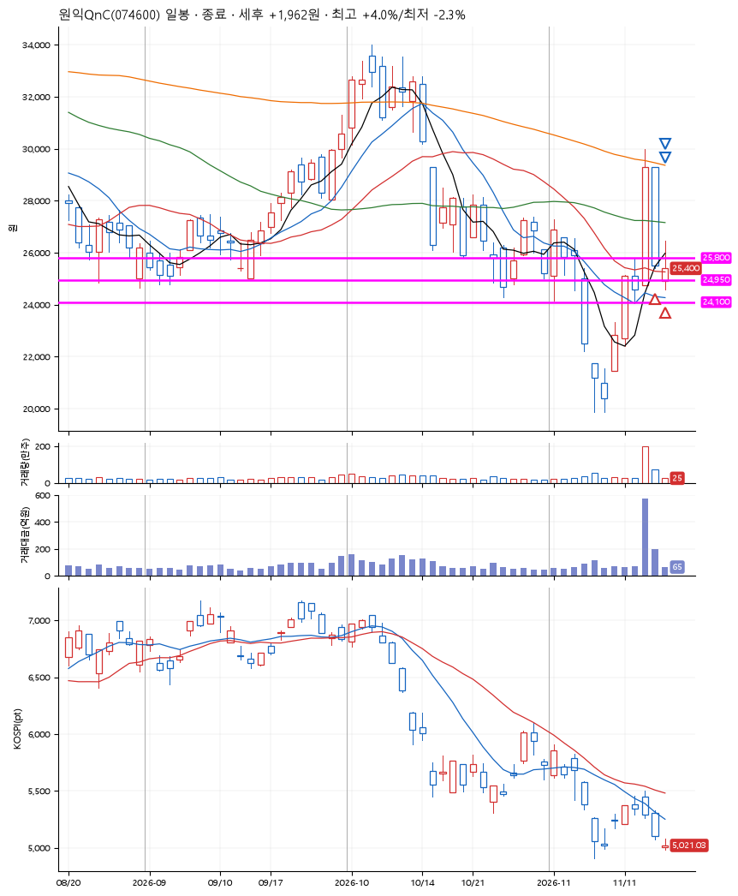
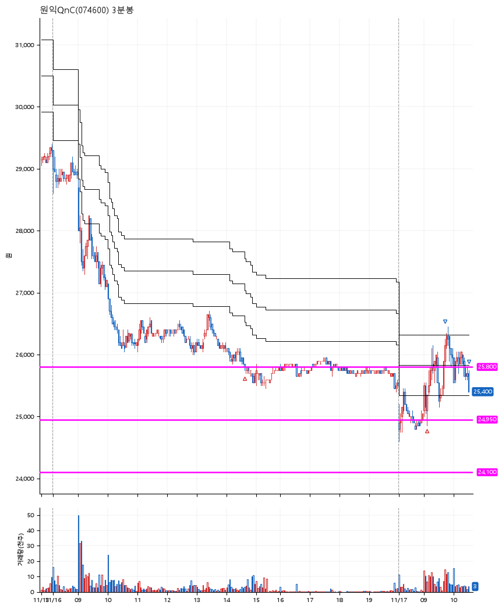

# 원익QnC(074600) · 2026-11-17

**2차 매수 → 3% 익절 → 본절 이탈**

진입 2026-11-16 14:38 (D+1) · 청산 2026-11-17 10:31 (D+2) · 보유 2일차

| | |
|---|---|
| 결과 | 익절 |
| 평단 / 수량 | 25,425원 · 10주 |
| 투입 | 254,250원 |
| 세후 손익 | +1,962원 (+0.77%) |
| 최고 / 최저 | +4.0% / -2.3% |
| 당일 등락 | -0.40% |
| 보유기간 | 2일차 |

## 3선

| | |
|---|---|
| 1선 | 25,800원 |
| 2선 | 24,950원 |
| 3선 | 24,100원 |

기준봉 2026-11-13 (D+2)

`#KOSPI하락횡보장` `#시장을이기는종목` `#테마주`

> 반도체

## 차트

**일봉**

**3분봉**

## 체결

| 시각 | 구분 | 수량 | 판정가 | 체결가 | 오차 |
|---|---|---|---|---|---|
| 14:38 | 매수 | 5주 | 25,800 | 25,850 | +0.19% |
| 09:06 | 매수 | 5주 | 24,950 | 25,000 | +0.20% |
| 09:44 | 매도 | 4주 | 26,200 | 26,100 | -0.38% |
| 10:31 | 매도 | 6주 | 25,400 | 25,400 | +0.00% |

## 잘한 점

_(미작성)_

## 아쉬운 점

_(미작성)_
