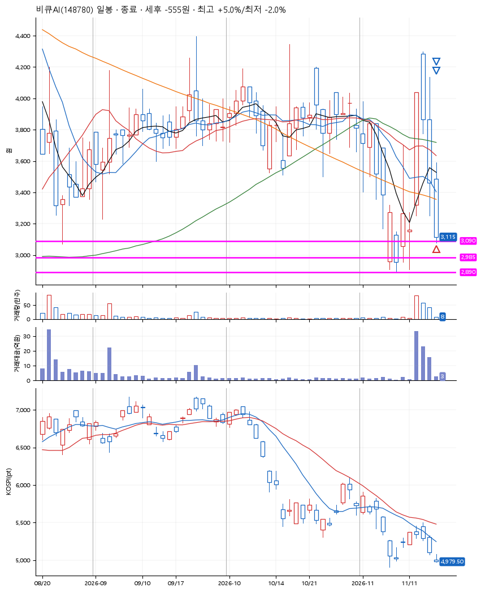
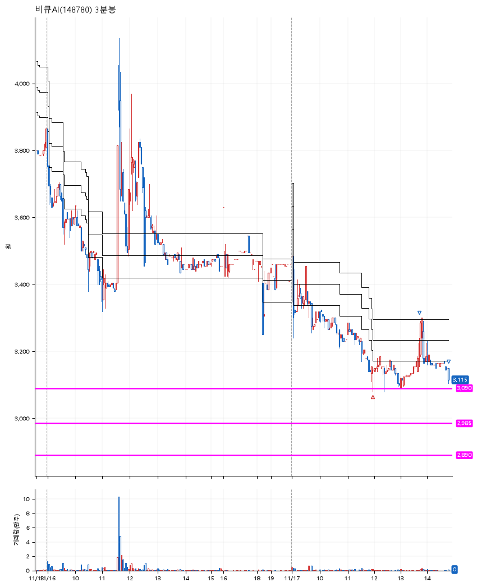

# 비큐AI(148780) · 2026-11-17

**1차 매수 → 3% 익절 → 본절 이탈**

진입 2026-11-17 11:58 (D+3) · 청산 2026-11-17 14:50 (D+3) · 보유 2시간 52분

| | |
|---|---|
| 결과 | 손절 |
| 평단 / 수량 | 3,144원 · 44주 |
| 투입 | 138,336원 |
| 세후 손익 | -555원 (-0.40%) |
| 최고 / 최저 | +5.0% / -2.0% |
| 당일 등락 | -9.61% |
| 보유기간 | 2시간 52분 |

## 3선

| | |
|---|---|
| 1선 | 3,090원 |
| 2선 | 2,985원 |
| 3선 | 2,890원 |

기준봉 2026-11-12 (D+3)

`#KOSPI하락횡보장` `#시장을이기는종목` `#상한가` `#테마주`

> 지능형로봇 인공지능

## 차트

**일봉**

**3분봉**

## 체결

| 시각 | 구분 | 수량 | 판정가 | 체결가 | 오차 |
|---|---|---|---|---|---|
| 11:58 | 매수 | 44주 | 3,080 | 3,144 | +2.08% |
| 13:42 | 매도 | 17주 | 3,240 | 3,176 | -1.98% |
| 14:50 | 매도 | 27주 | 3,140 | 3,115 | -0.80% |

## 잘한 점

_(미작성)_

## 아쉬운 점

_(미작성)_
