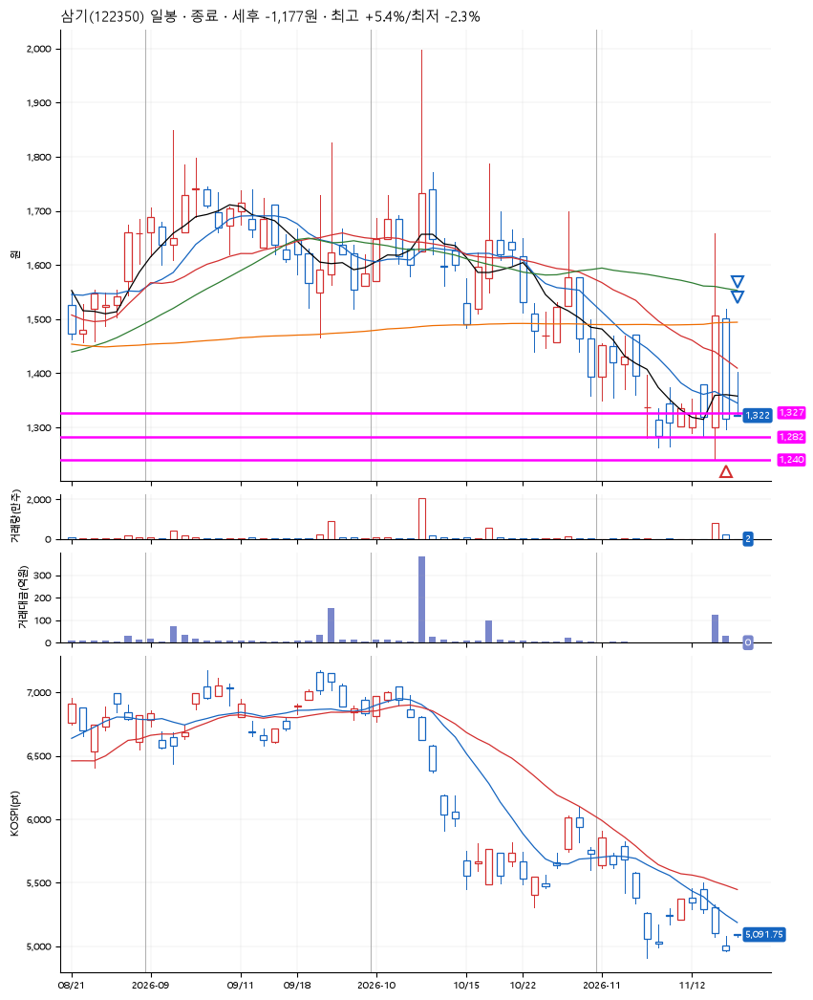
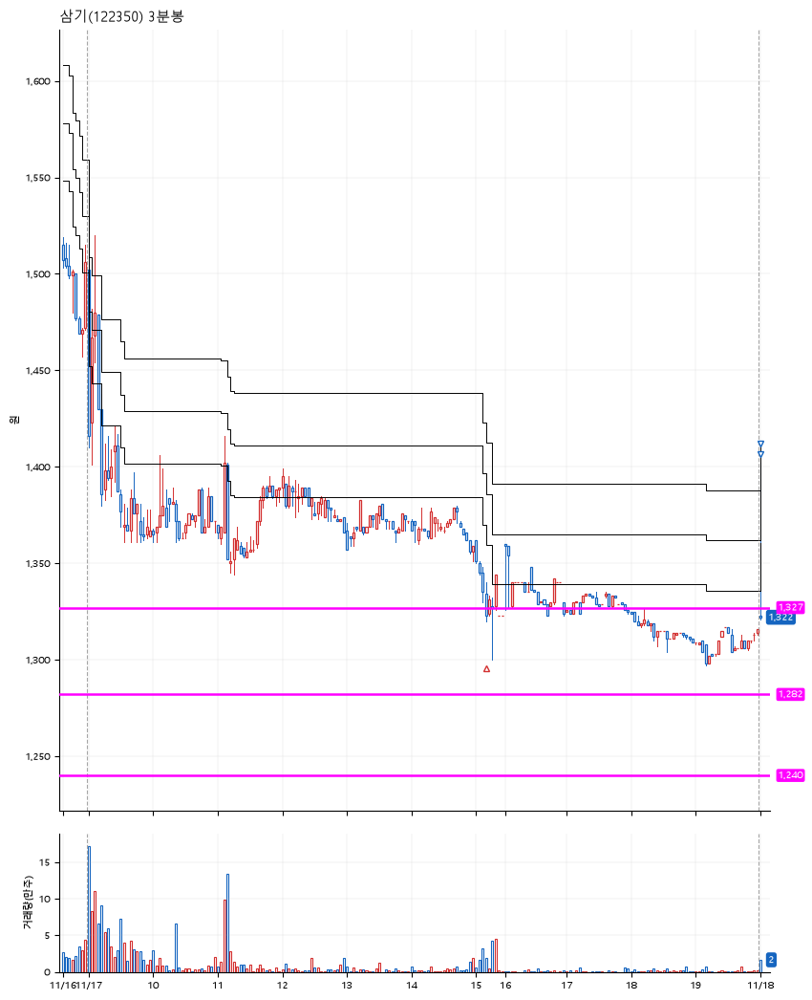

# 삼기(122350) · 2026-11-18

**1차 매수 → 3% 익절 → 본절 이탈**

진입 2026-11-17 15:09 (D+1) · 청산 2026-11-18 09:02 (D+2) · 보유 2일차

| | |
|---|---|
| 결과 | 손절 |
| 평단 / 수량 | 1,330원 · 103주 |
| 투입 | 136,990원 |
| 세후 손익 | -1,177원 (-0.86%) |
| 최고 / 최저 | +5.4% / -2.3% |
| 당일 등락 | +2.49% |
| 보유기간 | 2일차 |

## 3선

| | |
|---|---|
| 1선 | 1,327원 |
| 2선 | 1,282원 |
| 3선 | 1,240원 |

기준봉 2026-11-16 (D+2)

`#KOSPI하락횡보장` `#시장을이기는종목`

> 영업이익호조

## 차트

**일봉**

**3분봉**

## 체결

| 시각 | 구분 | 수량 | 판정가 | 체결가 | 오차 |
|---|---|---|---|---|---|
| 15:09 | 매수 | 103주 | 1,327 | 1,330 | +0.23% |
| 09:02 | 매도 | 41주 | 1,375 | 1,321 | -3.93% |
| 09:02 | 매도 | 62주 | 1,321 | 1,322 | +0.08% |

## 잘한 점

_(미작성)_

## 아쉬운 점

_(미작성)_
