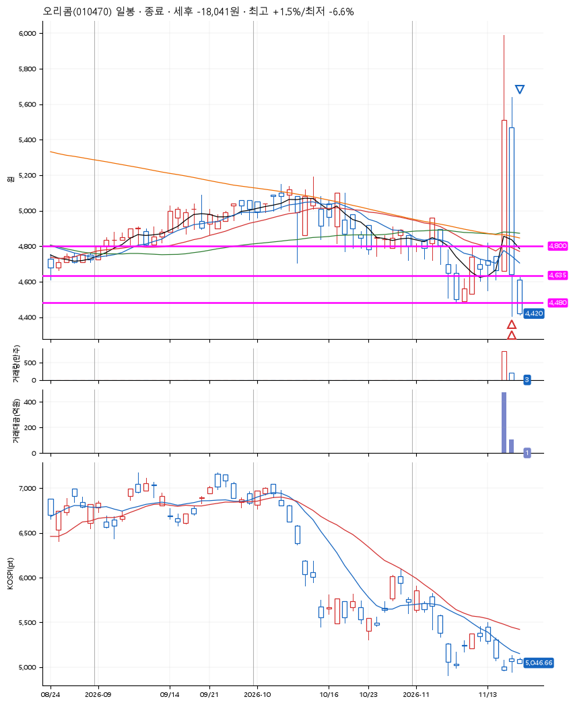
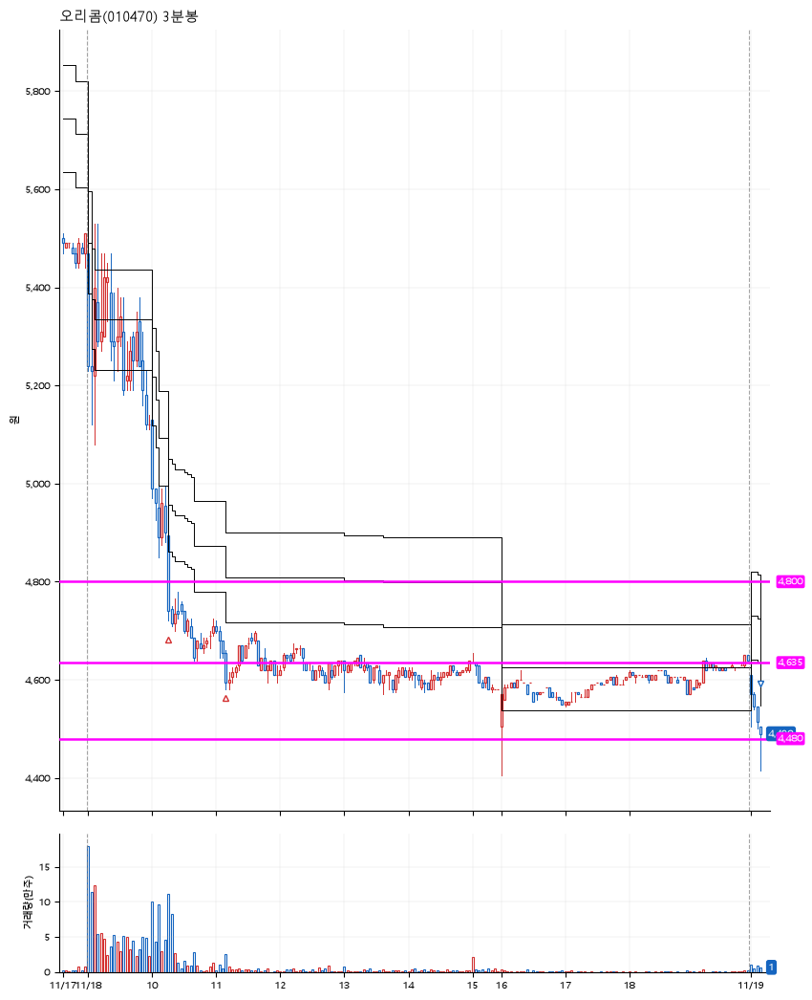

# 오리콤(010470) · 2026-11-19

**2차 매수 → 손절**

진입 2026-11-18 10:16 (D+1) · 청산 2026-11-19 10:09 (D+2) · 보유 2일차

| | |
|---|---|
| 결과 | 손절 |
| 평단 / 수량 | 4,726원 · 57주 |
| 투입 | 269,400원 |
| 세후 손익 | -18,041원 (-6.70%) |
| 최고 / 최저 | +1.5% / -6.6% |
| 당일 등락 | -1.53% |
| 보유기간 | 2일차 |

## 3선

| | |
|---|---|
| 1선 | 4,800원 |
| 2선 | 4,635원 |
| 3선 | 4,480원 |

기준봉 2026-11-17 (D+2)

`#KOSPI하락횡보장` `#시장을이기는종목`

> 호실적

## 차트

**일봉**

**3분봉**

## 체결

| 시각 | 구분 | 수량 | 판정가 | 체결가 | 오차 |
|---|---|---|---|---|---|
| 10:16 | 매수 | 28주 | 4,800 | 4,795 | -0.10% |
| 11:09 | 매수 | 29주 | 4,635 | 4,660 | +0.54% |
| 10:09 | 매도 | 57주 | 4,480 | 4,420 | -1.34% |

## 잘한 점

_(미작성)_

## 아쉬운 점

_(미작성)_
