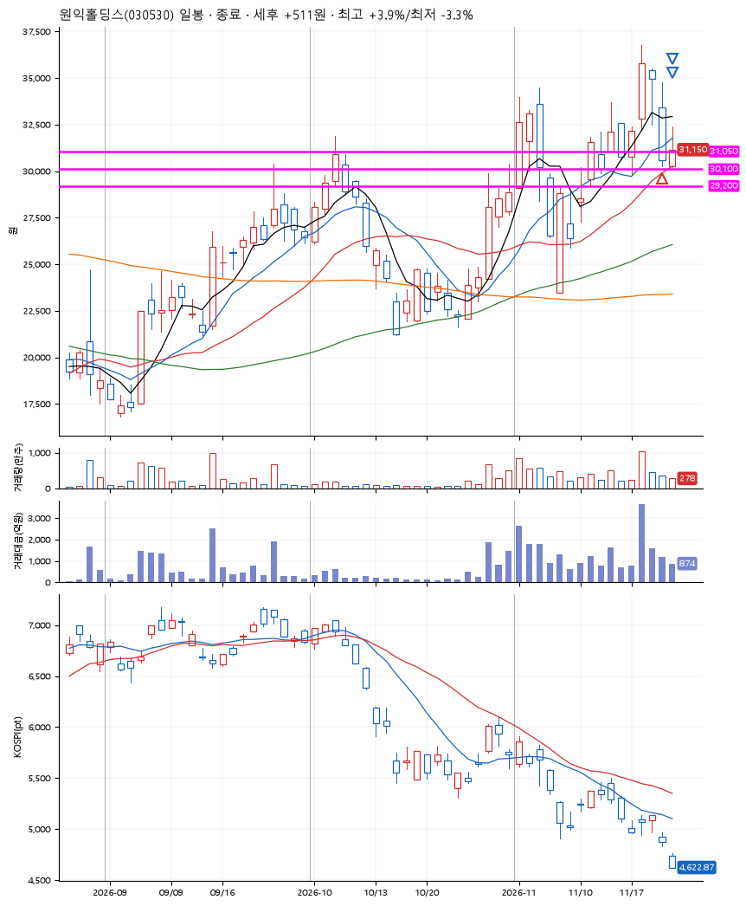
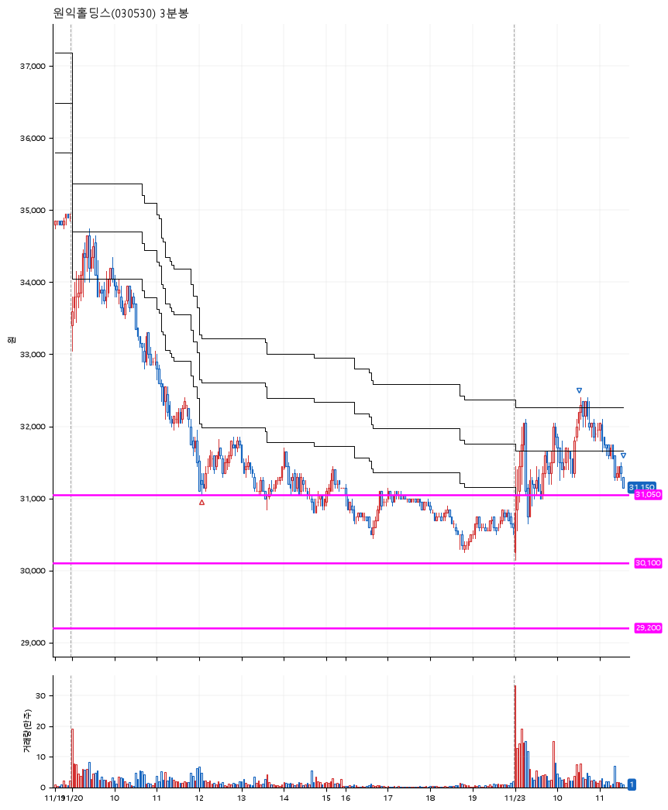

# 원익홀딩스(030530) · 2026-11-23

**1차 매수 → 3% 익절 → 본절 이탈**

진입 2026-11-20 12:05 (D+2) · 청산 2026-11-23 11:33 (D+3) · 보유 2일차

| | |
|---|---|
| 결과 | 익절 |
| 평단 / 수량 | 31,188원 · 4주 |
| 투입 | 124,752원 |
| 세후 손익 | +511원 (+0.41%) |
| 최고 / 최저 | +3.9% / -3.3% |
| 당일 등락 | +5.95% |
| 보유기간 | 4일차 |

## 3선

| | |
|---|---|
| 1선 | 31,050원 |
| 2선 | 30,100원 |
| 3선 | 29,200원 |

기준봉 2026-11-18 (D+3)

`#KOSPI하락횡보장` `#시장을이기는종목` `#테마주`

> 반도체 로봇

## 차트

**일봉**

**3분봉**

## 체결

| 시각 | 구분 | 수량 | 판정가 | 체결가 | 오차 |
|---|---|---|---|---|---|
| 12:05 | 매수 | 4주 | 31,050 | 31,188 | +0.44% |
| 10:32 | 매도 | 1주 | 32,150 | 32,100 | -0.16% |
| 11:33 | 매도 | 3주 | 31,150 | 31,150 | +0.00% |

## 잘한 점

_(미작성)_

## 아쉬운 점

_(미작성)_
