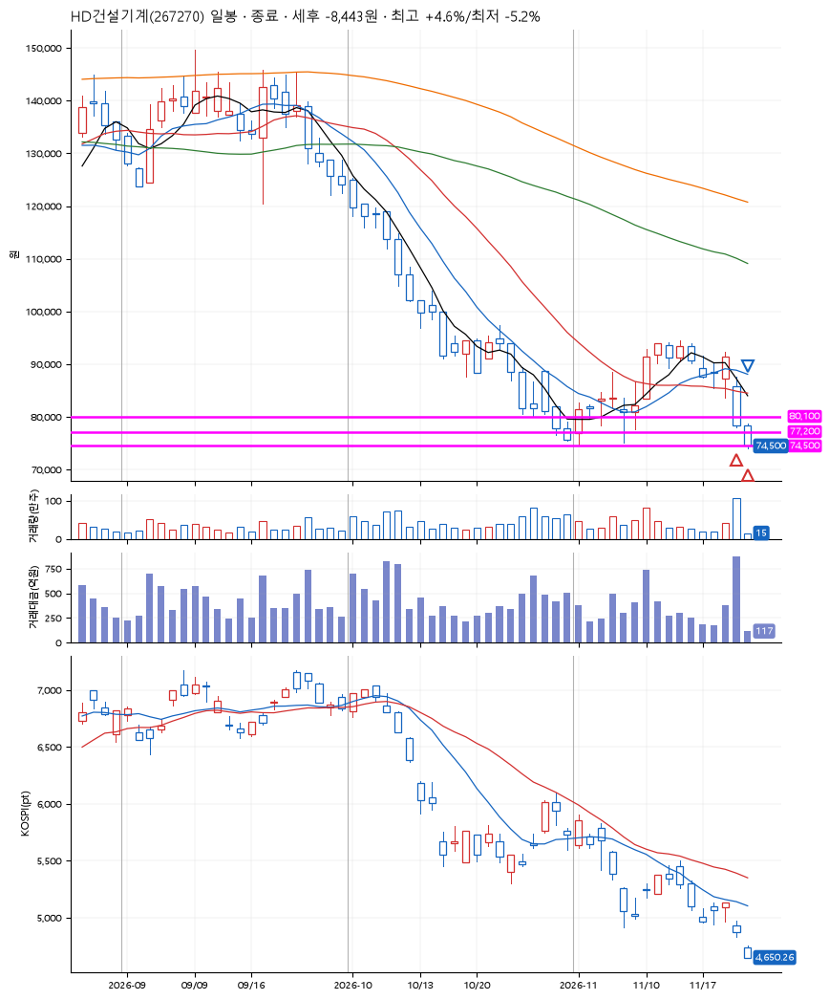
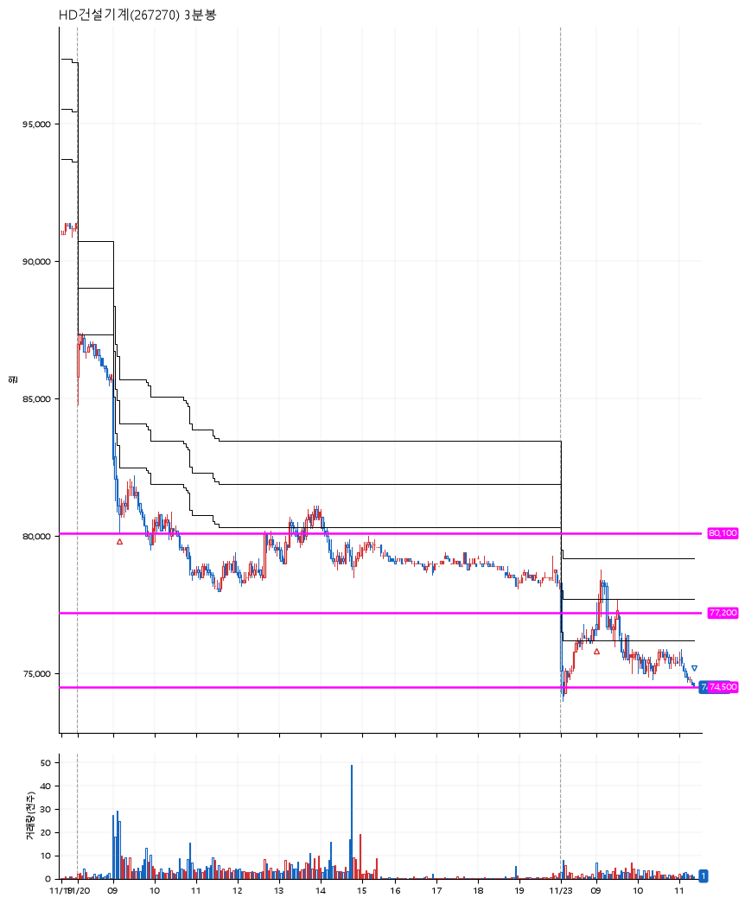

# HD건설기계(267270) · 2026-11-23

**2차 매수 → 손절**

진입 2026-11-20 09:10 (D+8) · 청산 2026-11-23 11:21 (D+9) · 보유 2일차

| | |
|---|---|
| 결과 | 손절 |
| 평단 / 수량 | 78,550원 · 2주 |
| 투입 | 157,100원 |
| 세후 손익 | -8,443원 (-5.37%) |
| 최고 / 최저 | +4.6% / -5.2% |
| 당일 등락 | -2.99% |
| 보유기간 | 4일차 |

## 3선

| | |
|---|---|
| 1선 | 80,100원 |
| 2선 | 77,200원 |
| 3선 | 74,500원 |

기준봉 2026-11-10 (D+9)

`#KOSPI하락횡보장` `#시장을이기는종목` `#테마주`

> 데이터센터 재건 건설기계

## 차트

**일봉**

**3분봉**

## 체결

| 시각 | 구분 | 수량 | 판정가 | 체결가 | 오차 |
|---|---|---|---|---|---|
| 09:10 | 매수 | 1주 | 80,100 | 80,300 | +0.25% |
| 09:00 | 매수 | 1주 | 76,800 | 76,800 | +0.00% |
| 11:21 | 매도 | 2주 | 74,500 | 74,500 | +0.00% |

## 잘한 점

_(미작성)_

## 아쉬운 점

_(미작성)_
