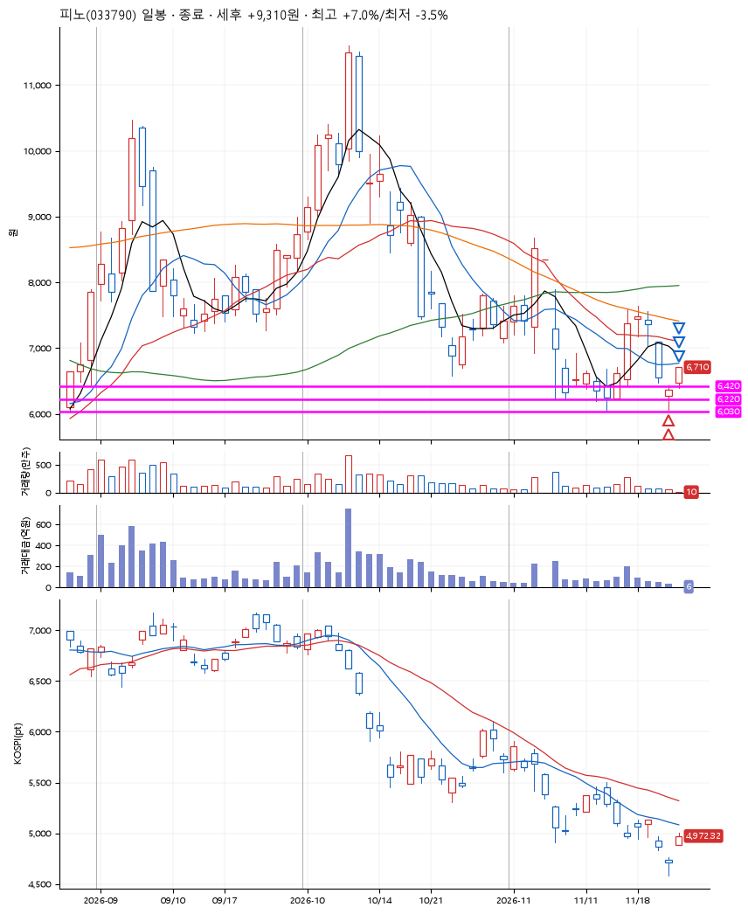
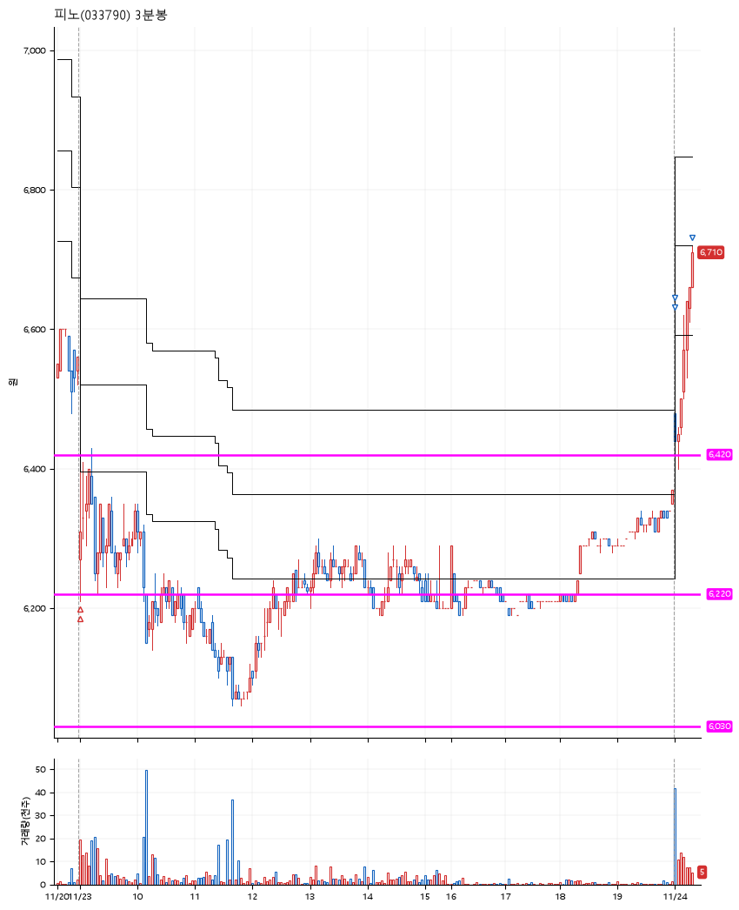

# 피노(033790) · 2026-11-24

**2차 매수 → 3% 익절 → 5% 익절 → 7% 익절**

진입 2026-11-23 09:00 (D+4) · 청산 2026-11-24 09:20 (D+5) · 보유 2일차

| | |
|---|---|
| 결과 | 익절 |
| 평단 / 수량 | 6,280원 · 43주 |
| 투입 | 270,050원 |
| 세후 손익 | +9,310원 (+3.45%) |
| 최고 / 최저 | +7.0% / -3.5% |
| 당일 등락 | +9.26% |
| 보유기간 | 2일차 |

## 3선

| | |
|---|---|
| 1선 | 6,420원 |
| 2선 | 6,220원 |
| 3선 | 6,030원 |

기준봉 2026-11-17 (D+5)

`#KOSPI하락횡보장` `#시장을이기는종목` `#테마주`

> 2차전지

## 차트

**일봉**

**3분봉**

## 체결

| 시각 | 구분 | 수량 | 판정가 | 체결가 | 오차 |
|---|---|---|---|---|---|
| 09:00 | 매수 | 21주 | 6,270 | 6,270 | +0.00% |
| 09:00 | 매수 | 22주 | 6,220 | 6,290 | +1.13% |
| 09:00 | 매도 | 17주 | 6,480 | 6,480 | +0.00% |
| 09:01 | 매도 | 21주 | 6,600 | 6,490 | -1.67% |
| 09:20 | 매도 | 5주 | 6,720 | 6,710 | -0.15% |

## 잘한 점

_(미작성)_

## 아쉬운 점

_(미작성)_
