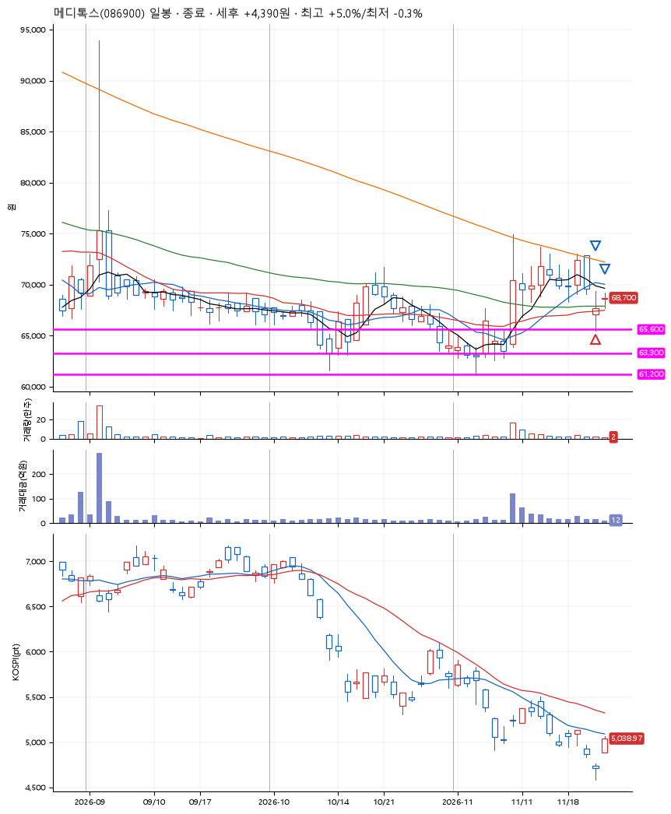
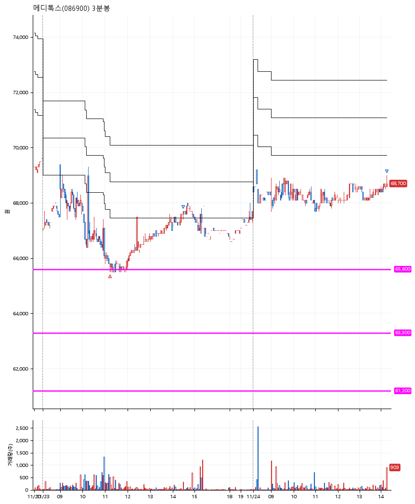

# 메디톡스(086900) · 2026-11-24

**1차 매수 → 3% 익절 → 5% 익절**

진입 2026-11-23 11:12 (D+9) · 청산 2026-11-24 14:17 (D+10) · 보유 2일차

| | |
|---|---|
| 결과 | 익절 |
| 평단 / 수량 | 65,700원 · 2주 |
| 투입 | 131,400원 |
| 세후 손익 | +4,390원 (+3.34%) |
| 최고 / 최저 | +5.0% / -0.3% |
| 당일 등락 | +2.51% |
| 보유기간 | 2일차 |

## 3선

| | |
|---|---|
| 1선 | 65,600원 |
| 2선 | 63,300원 |
| 3선 | 61,200원 |

기준봉 2026-11-10 (D+10)

`#KOSPI하락횡보장` `#시장을이기는종목`

## 차트

**일봉**

**3분봉**

## 체결

| 시각 | 구분 | 수량 | 판정가 | 체결가 | 오차 |
|---|---|---|---|---|---|
| 11:12 | 매수 | 2주 | 65,600 | 65,700 | +0.15% |
| 14:32 | 매도 | 1주 | 67,700 | 67,400 | -0.44% |
| 14:17 | 매도 | 1주 | 69,000 | 68,700 | -0.43% |

## 잘한 점

_(미작성)_

## 아쉬운 점

_(미작성)_
