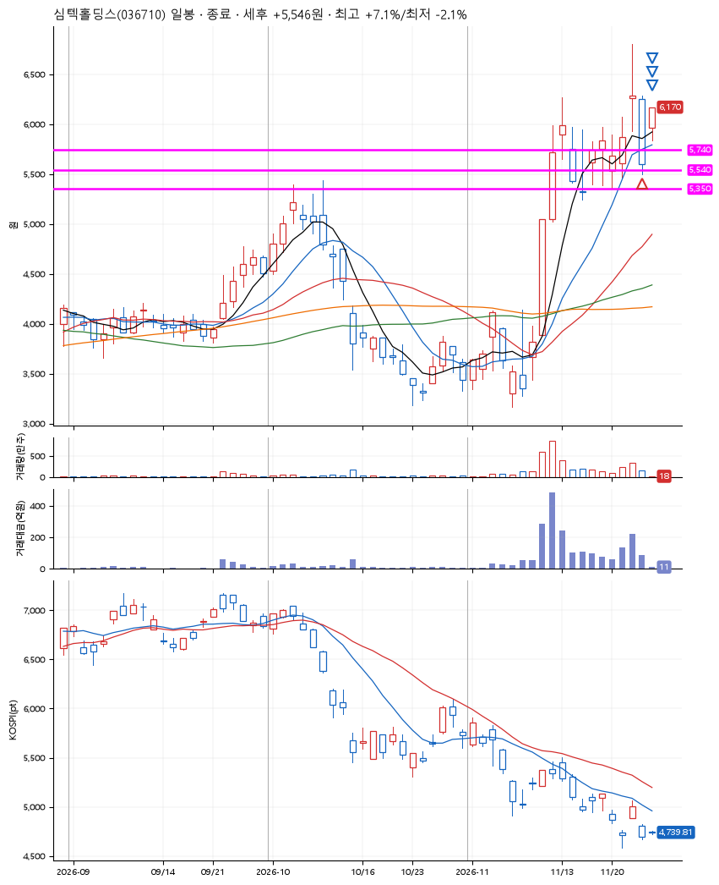
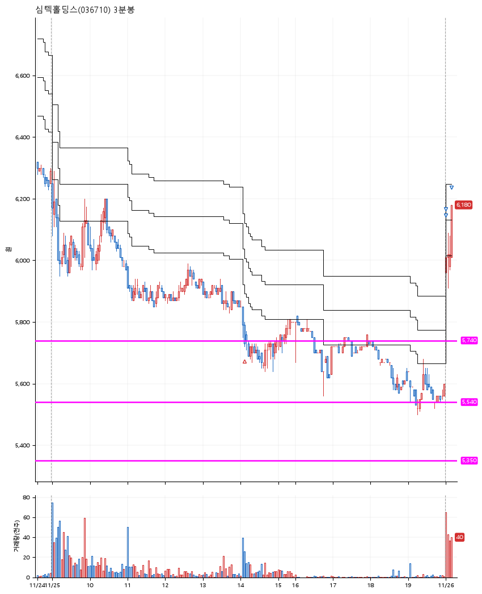

# 심텍홀딩스(036710) · 2026-11-26

**1차 매수 → 3% 익절 → 5% 익절 → 7% 익절**

진입 2026-11-25 14:08 (D+1) · 청산 2026-11-26 09:10 (D+2) · 보유 2일차

| | |
|---|---|
| 결과 | 익절 |
| 평단 / 수량 | 5,763원 · 23주 |
| 투입 | 132,549원 |
| 세후 손익 | +5,546원 (+4.18%) |
| 최고 / 최저 | +7.1% / -2.1% |
| 당일 등락 | +5.70% |
| 보유기간 | 2일차 |

## 3선

| | |
|---|---|
| 1선 | 5,740원 |
| 2선 | 5,540원 |
| 3선 | 5,350원 |

기준봉 2026-11-24 (D+2)

`#KOSPI하락횡보장` `#시장을이기는종목` `#테마주` `#섹터주`

> 반도체

## 차트

**일봉**

**3분봉**

## 체결

| 시각 | 구분 | 수량 | 판정가 | 체결가 | 오차 |
|---|---|---|---|---|---|
| 14:08 | 매수 | 23주 | 5,740 | 5,763 | +0.40% |
| 09:00 | 매도 | 9주 | 5,960 | 5,910 | -0.84% |
| 09:01 | 매도 | 11주 | 6,060 | 6,070 | +0.17% |
| 09:10 | 매도 | 3주 | 6,170 | 6,150 | -0.32% |

## 잘한 점

_(미작성)_

## 아쉬운 점

_(미작성)_
